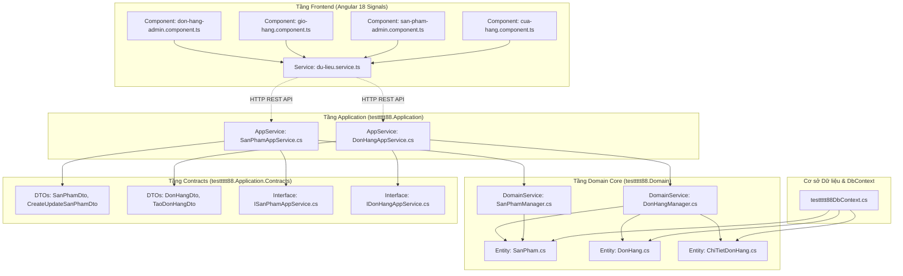

# SKILL: GRAPHIFY (DEPENDENCY KNOWLEDGE GRAPH)

> **Phân hệ:** Quản lý Phụ thuộc Mã nguồn & Phân tích Tác động (Impact Analysis)  
> **Áp dụng cho:** Hệ thống `testtttt88` (ASP.NET Core ABP Framework + Angular 18+)  
> **Sinh viên:** Nguyễn Khắc Dương (74DCTT22184) | **Giảng viên:** Thầy Tô Hải Thiên  

---

## 1. BẢN CHẤT CỦA SKILL GRAPHIFY
- **Định nghĩa:** Graphify là kỹ năng phân tích tĩnh mã nguồn (Static Code Analysis) dựa trên cây cú pháp trừu tượng (Abstract Syntax Tree - AST) nhằm xây dựng **Đồ thị tri thức phụ thuộc (Dependency Knowledge Graph)** cho toàn bộ hệ thống.
- **Mục đích:** Thay vì AI chỉ đọc từng file đơn lẻ trong Context Window, Graphify cung cấp cho AI cái nhìn toàn cảnh về mạng lưới phụ thuộc giữa các tầng kiến trúc:
  - Lớp nào kế thừa lớp nào?
  - Service nào inject vào Service nào?
  - API Backend nào đang phục vụ Component nào ở Frontend?
  - Khi sửa 1 hàm, những module nào sẽ bị tác động (Impact Analysis)?

---

## 2. BẢN ĐỒ ĐỒ THỊ QUAN HỆ KIẾN TRÚC DỰ ÁN (DEPENDENCY GRAPH)

---

## 3. NGUYÊN TẮC PHÂN TÍCH TÁC ĐỘNG (IMPACT ANALYSIS) CỦA AGENT

Trước khi thực hiện bất kỳ lệnh sửa đổi mã nguồn (Refactor/Edit) nào từ người dùng, AI Agent **bắt buộc tuân thủ 3 bước truy vết**:

1. **Bước 1: Định vị Node gốc (Source Node):**
   - Xác định file người dùng yêu cầu sửa thuộc tầng nào: Entity, Domain Manager, DTO, AppService hay UI Component.

2. **Bước 2: Quét nhánh phụ thuộc (Dependency Traversal):**
   - *Ví dụ:* Nếu sửa cấu trúc giá bán hoặc số lượng trong Entity `SanPham`:
     - Phải kiểm tra nhánh Domain: `SanPhamManager.cs` (kiểm tra tồn kho) và `DonHangManager.cs` (tính tổng tiền đơn hàng).
     - Phải kiểm tra nhánh Contracts: `SanPhamDto.cs` và `CreateUpdateSanPhamDto.cs`.
     - Phải kiểm tra nhánh Frontend: `du-lieu.service.ts` và giao diện `cua-hang.component.ts`, `gio-hang.component.ts`.

3. **Bước 3: Thực thi đồng bộ (Atomic Refactor):**
   - Cập nhật đồng thời từ tầng sâu nhất (Domain/Database) lên tầng giao diện (Frontend Models & UI) để tránh lỗi 500 hoặc lỗi lệch kiểu dữ liệu Runtime.
