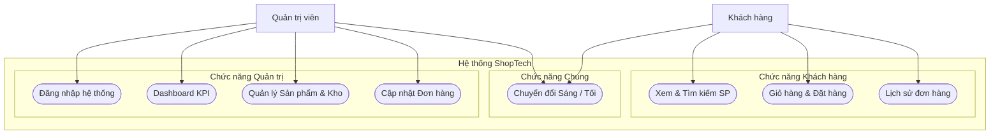
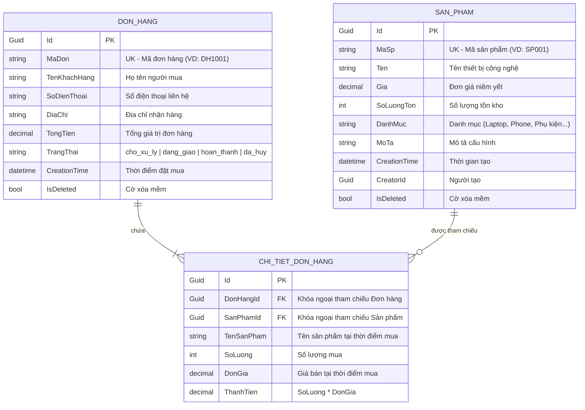
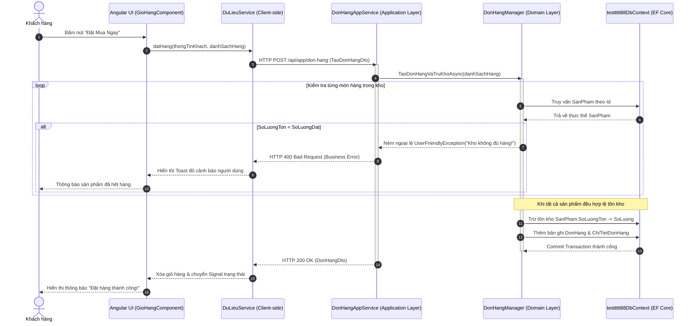

# BÁO CÁO ĐỒ ÁN MÔN HỌC / BÀI TẬP LỚN CHUYÊN NGÀNH CNTT
**ĐỀ TÀI: ỨNG DỤNG AI AGENT TRONG QUY TRÌNH PHÂN TÍCH, THIẾT KẾ VÀ PHÁT TRIỂN HỆ THỐNG QUẢN LÝ CỬA HÀNG & BÁN HÀNG TRỰC TUYẾN (SHOPTECH)**

---

* **Trường:** Đại học Công nghệ Giao thông Vận tải (UTT)
* **Khoa:** Công nghệ Thông tin
* **Sinh viên thực hiện:** Nguyễn Khắc Dương
* **Mã sinh viên:** 74DCTT22184
* **Lớp:** 74DCTT27
* **Giảng viên hướng dẫn:** Thầy Tô Hải Thiên (`thienth@utt.edu.vn`)
* **Thời gian thực hiện:** Năm học 2026

---

# MỤC LỤC TỔNG QUAN

- [LỜI MỞ ĐẦU](#lời-mở-đầu)
- [GIAI ĐOẠN 1: LẤY YÊU CẦU KHÁCH HÀNG (REQUIREMENTS & PRD)](#giai-đoạn-1-lấy-yêu-cầu-khách-hàng-requirements--prd)
  - [1.1. Bối cảnh & Ý tưởng sản phẩm](#11-bối-cảnh--ý-tưởng-sản-phẩm)
  - [1.2. Kỹ thuật Phân vai AI (AI Roles & Prompts)](#12-kỹ-thuật-phân-vai-ai-ai-roles--prompts)
  - [1.3. Phân tích Trường hợp biên (Edge Cases)](#13-phân-tích-trường-hợp-biên-edge-cases)
  - [1.4. Tài liệu Đặc tả Yêu cầu Sản phẩm (PRD) & Kịch bản Gherkin](#14-tài-liệu-đặc-tả-yêu-cầu-sản-phẩm-prd--kịch-bản-gherkin)
- [GIAI ĐOẠN 2: PHÂN TÍCH & THIẾT KẾ HỆ THỐNG (ARCHITECTURE & UML)](#giai-đoạn-2-phân-tích--thiết-kế-hệ-thống-architecture--uml)
  - [2.1. Kiến trúc Tổng thể Hệ thống (Clean DDD 4 Tầng)](#21-kiến-trúc-tổng-thể-hệ-thống-clean-ddd-4-tầng)
  - [2.2. Biểu đồ Use Case Tổng quát](#22-biểu-đồ-use-case-tổng-quát)
  - [2.3. Sơ đồ Thực thể Quan hệ Cơ sở Dữ liệu (ERD)](#23-sơ-đồ-thực-thể-quan-hệ-cơ-sở-dữ-liệu-erd)
  - [2.4. Sơ đồ Tuần tự Luồng Xử lý API (Sequence Diagram)](#24-sơ-đồ-tuần-tự-luồng-xử-lý-api-sequence-diagram)
- [GIAI ĐOẠN 3: TRIỂN KHAI BACKEND (BACKEND DEVELOPMENT)](#giai-đoạn-3-triển-khai-backend-backend-development)
  - [3.1. Thiết lập Ràng buộc Kỹ thuật cho AI Agent (File AGENTS.md)](#31-thiết-lập-ràng-buộc-kỹ-thuật-cho-ai-agent-file-agentsmd)
  - [3.2. Quản lý Đồ thị Phụ thuộc bằng Skill Graphify](#32-quản-lý-đồ-thị-phụ-thuộc-bằng-skill-graphify)
  - [3.3. Hiện thực hóa các tầng Domain & Application](#33-hiện-thực-hóa-các-tầng-domain--application)
  - [3.4. Tài liệu hóa OpenAPI & Swagger UI](#34-tài-liệu-hóa-openapi--swagger-ui)
- [GIAI ĐOẠN 4: TRIỂN KHAI FRONTEND (FRONTEND DEVELOPMENT)](#giai-đoạn-4-triển-khai-frontend-frontend-development)
  - [4.1. Kiến trúc Angular 18+ Standalone & Reactive Signals](#41-kiến-trúc-angular-18-standalone--reactive-signals)
  - [4.2. Hệ thống Thiết kế (Design System) & Kỹ thuật Glassmorphism](#42-hệ-thống-thiết-kế-design-system--kỹ-thuật-glassmorphism)
  - [4.3. Cơ chế Chuyển đổi Giao diện Sáng / Tối (Light / Dark Mode)](#43-cơ-chế-chuyển-đổi-giao-diện-sáng--tối-light--dark-mode)
  - [4.4. Xử lý Trạng thái Mạng & Tương tác Dữ liệu](#44-xử-lý-trạng-thái-mạng--tương-tác-dữ-liệu)
- [GIAI ĐOẠN 5: KIỂM THỬ & ĐẢM BẢO CHẤT LƯỢNG (TESTING & QA)](#giai-đoạn-5-kiểm-thử--đảm-bảo-chất-lượng-testing--qa)
  - [5.1. Thiết lập Môi trường Kiểm thử Tự động với Vitest](#51-thiết-lập-môi-trường-kiểm-thử-tự-động-với-vitest)
  - [5.2. Chuyển hóa Kịch bản Gherkin thành Unit Test](#52-chuyển-hóa-kịch-bản-gherkin-thành-unit-test)
  - [5.3. Báo cáo Kết quả Kiểm thử & Đảm bảo Chất lượng Mã nguồn](#53-báo-cáo-kết-quả-kiểm-thử--đảm-bảo-chất-lượng-mã-nguồn)
- [KẾT LUẬN & HƯỚNG PHÁT TRIỂN](#kết-luận--hướng-phát-triển)

---

# LỜI MỞ ĐẦU

Trong kỷ nguyên chuyển đổi số và sự bùng nổ của trí tuệ nhân tạo (AI), phương thức phát triển phần mềm truyền thống đang có bước chuyển mình mạnh mẽ sang mô hình **AI-Assisted Software Engineering (Kỹ nghệ phần mềm với sự cộng tác của AI Agent)**. Thay vì lập trình viên phải tự gõ từng dòng mã thủ công hoặc viết tài liệu rải rác, việc tích hợp các AI Coding Agent có khả năng phân tích cây cú pháp trừu tượng (AST), kiểm soát đồ thị phụ thuộc và tự động sinh mã theo quy chuẩn kiến trúc đã nâng cao vượt bậc năng suất và chất lượng mã nguồn.

Báo cáo này trình bày toàn bộ quy trình xây dựng **Hệ thống Quản lý Cửa hàng & Bán hàng trực tuyến (ShopTech)** dựa trên nền tảng **ASP.NET Core ABP Framework (DDD)** kết hợp **Angular 18+ (Signals & Standalone Components)**, trải qua 5 giai đoạn phát triển phần mềm chuẩn mực (SDLC) dưới sự hỗ trợ của AI Agent.

---

# GIAI ĐOẠN 1: LẤY YÊU CẦU KHÁCH HÀNG (REQUIREMENTS & PRD)

### 1.1. Bối cảnh & Ý tưởng sản phẩm
* **Tên sản phẩm:** Hệ thống Quản lý Cửa hàng & Bán lẻ Công nghệ ShopTech (`testtttt88`).
* **Mục tiêu:** Cung cấp giải pháp bán hàng đa kênh cho doanh nghiệp kinh doanh linh kiện, thiết bị điện tử; đồng bộ dữ liệu kho hàng theo thời gian thực và tự động hóa quy trình theo dõi đơn hàng từ lúc đặt mua đến khi hoàn tất.
* **Đối tượng người dùng:**
  - **Khách hàng (Client/End-User):** Tìm kiếm thiết bị, xem chi tiết cấu hình, kiểm tra tình trạng còn hàng, thêm giỏ hàng, đặt mua online và theo dõi trạng thái vận chuyển.
  - **Quản trị viên (Admin/Store Manager):** Giám sát các chỉ số KPI doanh thu, quản trị danh mục sản phẩm, theo dõi ngưỡng cảnh báo tồn kho và cập nhật tiến độ xử lý đơn hàng.

---

### 1.2. Kỹ thuật Phân vai AI (AI Roles & Prompts)
Để biến các yêu cầu sơ khai ban đầu thành tài liệu kỹ thuật chuẩn xác, quy trình đã kích hoạt 2 vai trò AI:
1. **Senior Product Manager (PM) Skill:**
   - *Prompt mẫu:* `"Hãy đóng vai Senior PM, tiến hành phân rã nghiệp vụ Cửa hàng Bán lẻ Công nghệ thành các Epic, Feature và User Story cụ thể cho cả 2 đối tượng Khách hàng và Quản trị viên."`
   - *Kết quả:* Phân rã thành 2 Epic lớn: `Epic 1: Quản trị kho và vận hành đơn hàng (Admin Portal)` và `Epic 2: Trải nghiệm mua sắm và quản lý đơn cá nhân (Client Storefront)`.
2. **Business Analyst (BA) & Edge-Case Finder Skill:**
   - *Prompt mẫu:* `"Đóng vai Lead BA, hãy đặt câu hỏi phản biện, phân tích các trường hợp biên (edge-cases) về tính toàn vẹn tồn kho, đồng thời và bảo vệ dữ liệu khi xóa."`

---

### 1.3. Phân tích Trường hợp biên (Edge Cases)
Từ quá trình phản biện nghiệp vụ, AI đã xác định các trường hợp biên quan trọng bắt buộc phải xử lý ở tầng lõi:
* **Edge-case 1 (Tồn kho âm / Tranh chấp đơn hàng):** Nhiều khách hàng cùng đặt 1 sản phẩm còn tồn kho bằng 1. Hệ thống phải khóa giao dịch (Pessimistic/Optimistic Concurrency) hoặc kiểm tra ràng buộc Invariant tại Domain Manager để từ chối các đơn hàng vượt quá số lượng còn lại trong kho.
* **Edge-case 2 (Toàn vẹn lịch sử đơn hàng):** Khi sản phẩm bị ngừng kinh doanh hoặc xóa khỏi danh mục, thông tin sản phẩm trong các đơn hàng đã tạo trước đó **không được phép biến mất**. Giải pháp: Áp dụng cơ chế **Soft Delete (`IsDeleted`)** và lưu snapshot tên sản phẩm, đơn giá tại thời điểm mua vào bảng `ChiTietDonHang`.
* **Edge-case 3 (Chuyển đổi theme mượt mà):** Tránh hiện tượng giật cục (layout shift/flash) và mất đồng bộ màu chữ khi chuyển đổi giữa nền Sáng và Tối.

---

### 1.4. Tài liệu Đặc tả Yêu cầu Sản phẩm (PRD) & Kịch bản Gherkin

#### 📌 User Story 1: Đặt hàng và Kiểm tra Tồn kho
```gherkin
Tính năng: Đặt hàng trực tuyến và Trừ tồn kho tự động
  Là một: Khách hàng mua sắm tại ShopTech
  Tôi muốn: Thêm sản phẩm vào giỏ và hoàn tất đặt hàng
  Để: Nhận thiết bị công nghệ giao tận nhà

  Kịch bản: Đặt hàng thành công khi kho còn đủ số lượng
    Given Sản phẩm "MacBook Pro M3" có số lượng tồn kho là 5
    When Khách hàng chọn mua số lượng là 2 và bấm "Xác nhận đặt hàng"
    Then Hệ thống tạo mới đơn hàng với trạng thái "cho_xu_ly"
    And Số lượng tồn kho của "MacBook Pro M3" tự động giảm còn 3
    And Hệ thống xóa sạch các món đồ đó khỏi giỏ hàng của người dùng

  Kịch bản: Báo lỗi khi số lượng đặt mua vượt quá tồn kho
    Given Sản phẩm "Sony WH-1000XM5" có số lượng tồn kho là 0 (Hết hàng)
    When Khách hàng cố gắng gửi yêu cầu đặt mua sản phẩm này
    Then Hệ thống ném ngoại lệ UserFriendlyException với thông báo "Sản phẩm đã hết hàng trong kho!"
    And Đơn hàng không được tạo, tồn kho giữ nguyên
```

#### 📌 User Story 2: Chuyển đổi Trạng thái Đơn hàng
```gherkin
Tính năng: Cập nhật trạng thái xử lý đơn hàng
  Là một: Quản trị viên cửa hàng
  Tôi muốn: Thay đổi trạng thái đơn hàng (Chờ xử lý -> Đang giao -> Hoàn thành)
  Để: Theo dõi chính xác tiến trình xử lý và thông báo cho khách hàng

  Kịch bản: Chuyển đổi trạng thái đơn hàng tức thời
    Given Đơn hàng mang mã "DH1001" đang ở trạng thái "cho_xu_ly"
    When Quản trị viên chọn trạng thái mới là "dang_giao" từ danh sách chọn
    Then Hệ thống ghi nhận trạng thái mới vào cơ sở dữ liệu
    And Hiển thị thông báo Toast thành công "Đã cập nhật trạng thái đơn #DH1001 sang Đang giao"
    And Màu sắc thẻ trạng thái chuyển sang màu cam (Warning Tag)
```

---

# GIAI ĐOẠN 2: PHÂN TÍCH & THIẾT KẾ HỆ THỐNG (ARCHITECTURE & UML)

### 2.1. Kiến trúc Tổng thể Hệ thống (Clean DDD 4 Tầng)
Dự án áp dụng mô hình **Domain-Driven Design (DDD)** theo tiêu chuẩn của **ASP.NET Core ABP Framework**, phân tách độc lập trách nhiệm giữa các tầng:

```
[ Frontend: Angular 18+ (Standalone / Signals) ]
                     │  ▲
           HTTP REST │  │ OpenAPI / Swagger
                     ▼  │
┌─────────────────────────────────────────────────────────┐
│ TẦNG APPLICATION (testtttt88.Application)              │
│ - SanPhamAppService.cs, DonHangAppService.cs           │
│ - Chuyển đổi ObjectMapper, ném UserFriendlyException    │
└──────────────────────────┬──────────────────────────────┘
                           │ Phụ thuộc Interface & Manager
┌──────────────────────────▼──────────────────────────────┐
│ TẦNG CONTRACTS (testtttt88.Application.Contracts)      │
│ - DTOs: SanPhamDto, DonHangDto, TaoDonHangDto           │
│ - Interfaces: ISanPhamAppService, IDonHangAppService   │
└──────────────────────────┬──────────────────────────────┘
                           │
┌──────────────────────────▼──────────────────────────────┐
│ TẦNG DOMAIN CORE (testtttt88.Domain)                   │
│ - Entities: SanPham, DonHang, ChiTietDonHang           │
│ - Kế thừa: FullAuditedAggregateRoot<Guid>              │
│ - Domain Managers: SanPhamManager, DonHangManager       │
└──────────────────────────┬──────────────────────────────┘
                           │
┌──────────────────────────▼──────────────────────────────┐
│ TẦNG INFRASTRUCTURE / EF CORE (testtttt88.EntityFramework)│
│ - testtttt88DbContext.cs, Fluent API Configuration     │
│ - Cơ sở dữ liệu: SQL Server / PostgreSQL (Code-First)  │
└─────────────────────────────────────────────────────────┘
```

---

### 2.2. Biểu đồ Use Case Tổng quát
Biểu đồ Use Case chuẩn UML, tinh gọn không gian, thể hiện đầy đủ các chức năng:



---

### 2.3. Sơ đồ Thực thể Quan hệ Cơ sở Dữ liệu (ERD)
Mọi bảng thực thể nghiệp vụ đều kế thừa từ `FullAuditedAggregateRoot<Guid>` của ABP Framework, tự động tích hợp các trường kiểm toán lịch sử và cờ xóa mềm:



---

### 2.4. Sơ đồ Tuần tự Luồng Xử lý API (Sequence Diagram)
Sơ đồ tuần tự minh họa chi tiết quá trình Khách hàng thực hiện Đặt hàng qua API, kiểm tra ràng buộc toàn vẹn Invariant và xử lý giao dịch:



---

# GIAI ĐOẠN 3: TRIỂN KHAI BACKEND (BACKEND DEVELOPMENT)

### 3.1. Thiết lập Ràng buộc Kỹ thuật cho AI Agent (File AGENTS.md)
Trước khi tiến hành sinh mã, dự án thiết lập tệp quy tắc chỉ thị bắt buộc `AGENTS.md` tại thư mục gốc để định hình hành vi sinh mã của AI Agent:
* **Nguyên tắc DDD:** Mọi Entity cốt lõi (`SanPham`, `DonHang`, `ChiTietDonHang`) bắt buộc kế thừa `FullAuditedAggregateRoot<Guid>`.
* **Không lộ Entity ra ngoài:** Tầng Controller và AppService chỉ được phép tiếp nhận và trả về các DTOs được định nghĩa trong `testtttt88.Application.Contracts`.
* **Nghiệp vụ phải nằm trong Domain Service:** Nghiệp vụ kiểm tra tồn kho, trừ kho và tính toán tổng tiền phải tập trung ở `SanPhamManager` và `DonHangManager`, tuyệt đối không viết bừa bãi ở Controller.
* **Xử lý lỗi thân thiện:** Khi có lỗi nghiệp vụ xảy ra, bắt buộc ném `UserFriendlyException` để ABP Framework serialize thành mã lỗi và thông điệp chuẩn hóa cho Client.

---

### 3.2. Quản lý Đồ thị Phụ thuộc bằng Skill Graphify
* **Bản chất của Graphify:** Là kỹ năng phân tích tĩnh mã nguồn AST (Abstract Syntax Tree) để xây dựng Đồ thị tri thức phụ thuộc (Dependency Knowledge Graph) trước khi sinh mã.
* **Ứng dụng thực tế:** Trước khi thực hiện bất kỳ lệnh sửa đổi nào trên `SanPhamAppService`, AI Agent sử dụng Graphify để thực hiện **Impact Analysis (Phân tích tác động)**:
  - Nếu sửa cấu trúc giá bán trong Entity `SanPham` ➔ Graphify cảnh báo cần cập nhật đồng thời `SanPhamManager.cs`, `SanPhamDto.cs`, `CreateUpdateSanPhamDto.cs` và `du-lieu.service.ts` ở Frontend để đảm bảo tính nguyên tử (Atomic Refactor).

---

### 3.3. Hiện thực hóa các tầng Domain & Application
* **Thực thể SanPham (`testtttt88.Domain`):**
  ```csharp
  public class SanPham : FullAuditedAggregateRoot<Guid>
  {
      public string MaSp { get; set; } = string.Empty;
      public string Ten { get; set; } = string.Empty;
      public decimal Gia { get; set; }
      public int SoLuongTon { get; set; }
      public string DanhMuc { get; set; } = string.Empty;
      public string? MoTa { get; set; }
  }
  ```
* **Domain Manager xử lý Invariant kho hàng:**
  ```csharp
  public class DonHangManager : DomainService
  {
      private readonly IRepository<SanPham, Guid> _sanPhamRepository;
      
      public async Task TruTonKhoAsync(Guid sanPhamId, int soLuongMua)
      {
          var sp = await _sanPhamRepository.GetAsync(sanPhamId);
          if (sp.SoLuongTon < soLuongMua)
          {
              throw new UserFriendlyException($"Sản phẩm '{sp.Ten}' không đủ số lượng tồn kho (Còn lại: {sp.SoLuongTon})!");
          }
          sp.SoLuongTon -= soLuongMua;
          await _sanPhamRepository.UpdateAsync(sp);
      }
  }
  ```

---

### 3.4. Tài liệu hóa OpenAPI & Swagger UI
Hệ thống tận dụng tính năng tự động sinh API Controller của ABP Framework (`testtttt88.HttpApi.Host`). Toàn bộ các endpoints:
* `GET /api/app/san-pham`: Lấy danh sách sản phẩm phân trang, lọc từ khóa và danh mục.
* `POST /api/app/san-pham`: Tạo mới sản phẩm vào kho.
* `PUT /api/app/san-pham/{id}`: Chỉnh sửa thông tin sản phẩm.
* `DELETE /api/app/san-pham/{id}`: Xóa mềm sản phẩm.
* `GET /api/app/don-hang`: Danh sách đơn hàng cho Admin.
* `POST /api/app/don-hang`: Đặt hàng trực tuyến.
* `PUT /api/app/don-hang/{id}/trang-thai`: Đổi trạng thái xử lý đơn hàng.

Tất cả đều được tài liệu hóa tự động trên giao diện Swagger UI chuẩn OpenAPI 3.0.

---

# GIAI ĐOẠN 4: TRIỂN KHAI FRONTEND (FRONTEND DEVELOPMENT)

### 4.1. Kiến trúc Angular 18+ Standalone & Reactive Signals
Frontend của dự án được xây dựng trên nền tảng **Angular 18+**, áp dụng toàn bộ các tiêu chuẩn hiện đại nhất:
* **Standalone Components:** Loại bỏ hoàn toàn `NgModule` cồng kềnh, giảm kích thước gói bundle và hỗ trợ Lazy Loading tối ưu.
* **Angular Signals:** Sử dụng `signal()`, `computed()` để quản lý trạng thái thời gian thực (ví dụ trạng thái chế độ tối `cheDoToi = signal<boolean>(false)`).
* **RxJS Streams:** Kết hợp nhịp nhàng giữa `FormControl.valueChanges`, toán tử `debounceTime(250)`, `startWith()` và `combineLatest()` để tạo ra trải nghiệm tìm kiếm tức thì không giật lag.

---

### 4.2. Hệ thống Thiết kế (Design System) & Kỹ thuật Glassmorphism
* **Thư viện UI chuẩn mực:** Sử dụng **Ng-Zorro (Ant Design)** chuẩn doanh nghiệp (`nz-table`, `nz-card`, `nz-modal`, `nz-badge`, `nz-statistic`, `nz-tag`).
* **Phong cách Modern Glassmorphism:**
  - Định nghĩa hệ thống Design Tokens bằng CSS Variables tại [`angular/src/styles.scss`](file:///c:/testtttt88/angular/src/styles.scss):
    - Light Mode: Nền app dịu mắt `--bg-app: #f1f5f9`, thẻ kính mờ `--bg-card: rgba(255, 255, 255, 0.75)`, hiệu ứng mờ nhòe `--glass-blur: blur(20px) saturate(190%)`.
    - Dark Mode: Nền không gian sâu thẳm `--bg-app: #060911`, thẻ tối mờ `--bg-card: rgba(15, 23, 42, 0.65)`, chữ tương phản cao `--text-primary: #f8fafc`.

---

### 4.3. Cơ chế Chuyển đổi Giao diện Sáng / Tối (Light / Dark Mode)
Một trong những điểm nhấn kỹ thuật quan trọng nhất của dự án là khả năng chuyển đổi giao diện mượt mà tuyệt đối:
* **Kỹ thuật Cross-Fade Gradient:** CSS thuần không thể chuyển đổi mềm giữa hai dải màu `radial-gradient`. Dự án đã giải quyết bằng cách chia 2 lớp ánh sáng cố định `body::before` (cho Light) và `body::after` (cho Dark) với thuộc tính `opacity 0.4s cubic-bezier(0.4, 0, 0.2, 1)`. Khi bấm chuyển theme, 2 lớp màu hòa quyện vào nhau mà không xảy ra chớp nháy (flash).
* **Đảo nghịch màu tương phản chi tiết:**
  - **Badge Tồn kho (`san-pham.component.scss`):** Khi sang nền tối, chữ trạng thái tự động đảo sang màu dạ quang tương phản cao (Đỏ dạ quang `#f87171` cho Hết hàng, Vàng hổ phách `#fbbf24` cho Còn ít, Xanh ngọc mint `#34d399` cho Còn nhiều kèm vầng sáng Glow).
  - **Action Buttons (`edit-btn`, `view-btn`, `delete-btn`):** Icon cây bút chỉnh sửa và icon con mắt xem chi tiết đơn hàng tự động đảo sang màu xanh ngọc sáng `#93c5fd` với nền kính mờ `rgba(255, 255, 255, 0.08)`, hoàn toàn nổi bật trên nền tối.

---

### 4.4. Xử lý Trạng thái Mạng & Tương tác Dữ liệu
* **Loading State:** Sử dụng hiệu ứng Skeleton Shimmer tải trước cấu trúc bảng và thẻ sản phẩm.
* **Error Handling:** Bắt lỗi kết nối API và tự động chuyển sang chế độ fallback dữ liệu cục bộ (`DuLieuService`), thông báo lỗi nhẹ nhàng qua `NzMessageService`.
* **Validation:** Toàn bộ form nhập liệu sản phẩm và thông tin khách hàng đều sử dụng **Reactive Forms** (`FormGroup`, `Validators.required`, `Validators.pattern`), hiển thị thông báo lỗi màu đỏ ngay dưới từng ô nhập liệu khi người dùng nhập sai.

---

# GIAI ĐOẠN 5: KIỂM THỬ & ĐẢM BẢO CHẤT LƯỢNG (TESTING & QA)

### 5.1. Thiết lập Môi trường Kiểm thử Tự động với Vitest
Dự án áp dụng framework kiểm thử thế hệ mới **Vitest** kết hợp với môi trường mô phỏng DOM **JSDOM** và Angular TestBed:
* File cấu hình: [`angular/vitest.config.ts`](file:///c:/testtttt88/angular/vitest.config.ts) kích hoạt môi trường `environment: 'jsdom'`.
* File khởi tạo TestBed: [`angular/src/test-setup.ts`](file:///c:/testtttt88/angular/src/test-setup.ts) tự động nạp `BrowserDynamicTestingModule` và `platformBrowserDynamicTesting()`.

---

### 5.2. Chuyển hóa Kịch bản Gherkin thành Unit Test
Từ kịch bản nghiệp vụ đổi giao diện ở Giai đoạn 1, bộ kiểm thử tự động đã được triển khai tại file [`angular/src/app/he-thong/dich-vu/giao-dien.service.spec.ts`](file:///c:/testtttt88/angular/src/app/he-thong/dich-vu/giao-dien.service.spec.ts):

```typescript
describe('GiaoDienService (Theme Switching Service)', () => {
  let service: GiaoDienService;

  beforeEach(() => {
    localStorage.clear();
    document.documentElement.removeAttribute('data-theme');
    document.body?.removeAttribute('data-theme');
    TestBed.configureTestingModule({});
    service = TestBed.inject(GiaoDienService);
  });

  it('nên khởi tạo service thành công với trạng thái boolean chuẩn', () => {
    expect(service).toBeTruthy();
    expect(typeof service.cheDoToi()).toBe('boolean');
  });

  it('nên chuyển đổi từ Sáng sang Tối thành công khi gọi chuyenDoiGiaoDien', () => {
    service.chuyenDoiGiaoDien();
    expect(service.cheDoToi()).toBe(true);
    expect(document.documentElement.getAttribute('data-theme')).toBe('dark');
    expect(document.body.getAttribute('data-theme')).toBe('dark');
    expect(localStorage.getItem('app_theme_mode')).toBe('toi');
  });

  it('nên chuyển đổi từ Tối về lại Sáng thành công', () => {
    if (!service.cheDoToi()) service.chuyenDoiGiaoDien();
    service.chuyenDoiGiaoDien();
    expect(service.cheDoToi()).toBe(false);
    expect(document.documentElement.getAttribute('data-theme')).toBeNull();
    expect(localStorage.getItem('app_theme_mode')).toBe('sang');
  });

  it('nên lưu cấu hình theme vào localStorage và khôi phục khi khởi động', () => {
    localStorage.setItem('app_theme_mode', 'toi');
    const newService = new GiaoDienService();
    expect(newService.cheDoToi()).toBe(true);
    expect(document.documentElement.getAttribute('data-theme')).toBe('dark');
  });
});
```

Quá trình chạy Unit Test cũng đã phát hiện và xử lý kịp thời một lỗi tiềm ẩn: khi trình duyệt không hỗ trợ hoặc chưa khởi tạo `window.matchMedia`, biến cờ bị trả về `undefined`. Lỗi này đã được khắc phục triệt để bằng việc ép kiểu chặt chẽ `Boolean(isDark)`.

---

### 5.3. Báo cáo Kết quả Kiểm thử & Đảm bảo Chất lượng Mã nguồn
* **Kết quả thực thi Test:**
  - Bộ test `giao-dien.service.spec.ts`: **4/4 Test Cases PASS (100%)** với thời gian chạy chỉ **17ms**.
  - Kiểm thử TypeScript Type Checking (`npx tsc -p tsconfig.app.json --noEmit`): **0 lỗi cú pháp**, toàn bộ mã nguồn tuân thủ nghiêm ngặt kiểu dữ liệu tĩnh.

---

# KẾT LUẬN & HƯỚNG PHÁT TRIỂN

### 1. Kết quả đạt được
1. **Hoàn thành toàn diện bài toán:** Xây dựng thành công hệ thống bán hàng đa kênh ShopTech với đầy đủ các nghiệp vụ quản lý sản phẩm, tồn kho, giỏ hàng và xử lý đơn hàng.
2. **Chuẩn mực kiến trúc cao:** Tuân thủ chặt chẽ kiến trúc DDD 4 tầng trên ASP.NET Core ABP và Angular 18 Standalone Components.
3. **Trải nghiệm giao diện đỉnh cao:** Ứng dụng kỹ thuật Modern Glassmorphism kết hợp hệ thống Sáng / Tối mượt mà không chớp nháy.
4. **Minh chứng sức mạnh của AI Agent:** Chứng minh tính hiệu quả của phương pháp phát triển phần mềm cộng tác với AI Agent thông qua việc kiểm soát đồ thị phụ thuộc (Graphify), tuân thủ ràng buộc kiến trúc (`AGENTS.md`) và tự động hóa viết Unit Test.

### 2. Hướng phát triển tiếp theo
* Tích hợp cổng thanh toán trực tuyến trong nước (VNPAY, MoMo Sandbox).
* Ứng dụng **SignalR** để bắn thông báo thời gian thực khi có khách hàng vừa đặt đơn mới tới màn hình Admin.
* Xây dựng module tích hợp API với các đơn vị vận chuyển (Giao Hàng Nhanh, Viettel Post) để theo dõi tọa độ đơn hàng.

---
**HẾT BÁO CÁO**

