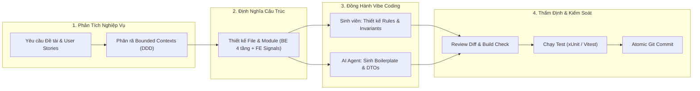
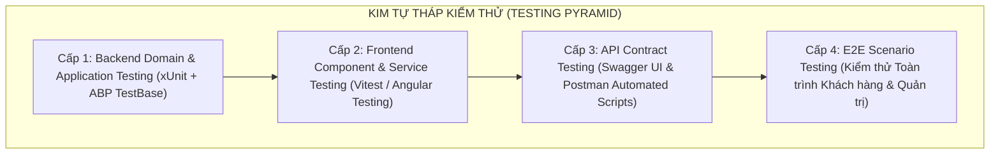

# BÁO CÁO TIẾN ĐỘ BÀI TẬP LỚN (ĐỢT 2 - NGÀY 11/10/2026)
## HỆ THỐNG QUẢN LÝ CỬA HÀNG & BÁN HÀNG TRỰC TUYẾN (testtttt88)
### BÁO CÁO Ý HIỂU HỆ THỐNG, KỸ NĂNG KIỂM SOÁT MÃ NGUỒN VÀ NĂNG LỰC VIBE CODING VỚI AI AGENT

> **Học phần:** Phát triển Ứng dụng & Bài tập lớn Chuyên ngành  
> **Giảng viên hướng dẫn:** **Thầy Tô Hải Thiên** (`thienth@utt.edu.vn`)  
> **Sinh viên thực hiện:** **Nguyễn Khắc Dương** | **MSV:** **74DCTT22184** | **Lớp:** **74DCTT27**  
> **Khoa / Trường:** Khoa Công nghệ Thông tin - Trường Đại học Công nghệ Giao thông Vận tải (UTT)  
> **Mã nguồn dự án (Public):** [https://github.com/Nguyen-Khac-Duong/baitaploncuoiky.git](https://github.com/Nguyen-Khac-Duong/baitaploncuoiky.git)  
> **Mốc báo cáo:** **Đợt 2 - Báo cáo ngày 11/10/2026** (Tập tin: `README_11_11.md`)  
> *(Xem lại báo cáo nền tảng Đợt 1 ngày 04/10/2026 tại [README_4_11.md](file:///c:/testtttt88/README_4_11.md))*

---

## 📌 LỜI MỞ ĐẦU & ĐỊNH HƯỚNG BÁO CÁO THEO YÊU CẦU CỦA GIẢNG VIÊN

Tiếp thu ý kiến chỉ đạo trực tiếp của **Thầy Tô Hải Thiên**:
> *"Thay vì chỉ liệt kê các tính năng chung chung hay chia việc trong nhóm, báo cáo này tập trung chứng minh năng lực thực tế của sinh viên trong thời đại **Vibe Coding**: Làm thế nào để tự mình xây dựng và làm chủ hoàn toàn 1 hệ thống phần mềm hoàn chỉnh dưới sự trợ giúp của AI Agent; Nắm rõ từng dòng mã nguồn, từng luồng sự kiện (Event Flow) ở đâu và cách can thiệp sửa đổi; Sử dụng thành thạo các kỹ năng như Graphify, công cụ Log, Diff để quản trị mã nguồn và đóng vai trò Leader đánh giá hiệu quả; Đồng thời biết kết hợp các công cụ kiểm thử nâng cao."*

Báo cáo này được cấu trúc bám sát **3 Ý lớn trọng tâm** theo thang điểm đánh giá của giảng viên:
1. **Ý 1 (3 điểm):** Phương pháp phân tích và xây dựng hệ thống với sự trợ giúp của AI Agent.
2. **Ý 2 (5 điểm):** Kỹ năng kiểm soát mã nguồn:
   - **a)** Kiểm soát tính năng & toàn bộ các thao tác luồng sự kiện trong hệ thống (vị trí file, hàm, cách sửa đổi).
   - **b)** Kỹ năng sử dụng Skill: Graphify và các bộ kỹ năng hỗ trợ viết code.
   - **c)** Ý hiểu sâu sắc về công cụ Log, Diff và vai trò Leader đánh giá hiệu quả thành viên.
3. **Ý 3 (2 điểm):** Kỹ năng kết hợp các công cụ kiểm thử tính năng nâng cao (Testing Pyramid & Test-Driven Prompting).

---

# 🌟 PHẦN 1: Ý 1 - PHƯƠNG PHÁP XÂY DỰNG HỆ THỐNG VỚI SỰ TRỢ GIÚP CỦA AI AGENT (3 ĐIỂM)



### 1.1. Em đã dùng gì để phân tích hệ thống?
Để không bị rơi vào cái bẫy "vibe coding mất kiểm soát" (viết code lung tung không có định hướng), em đã áp dụng phương pháp phân tích hệ thống theo quy trình kỹ thuật phần mềm chuẩn:
1. **Phân tích User Stories & Phân rã Nghiệp vụ theo DDD (Domain-Driven Design):**
   - Xác định 4 **Bounded Contexts** độc lập:
     - **Context Sản phẩm & Kho hàng (Catalog & Inventory):** Quản lý vòng đời sản phẩm, mã SKU, danh mục, giá bán và số lượng tồn kho.
     - **Context Đơn hàng & Thanh toán (Orders & Checkout):** Quy trình tạo đơn, tính tiền, trừ kho nguyên tử (Atomic Deduction) và chuyển đổi trạng thái đơn.
     - **Context Xác thực & Phân quyền (Auth & Identity):** RBAC phân biệt Quản trị viên (`admin`) và Khách hàng (`khach_hang`).
     - **Context Trợ lý Thông minh (AI Assistant):** Chatbot tư vấn ngữ cảnh thời gian thực dựa trên danh mục hàng có sẵn trong kho.
2. **Kỹ thuật "Context Engineering" & "Architectural Prompting":**
   - Trước khi để AI sinh mã, em định nghĩa sẵn bộ khung kiến trúc: **ASP.NET Core ABP Framework (DDD 4 tầng)** cho Backend và **Angular 18 Standalone Components + Signals** cho Frontend.
   - Cung cấp sơ đồ quan hệ thực thể (ERD), ràng buộc toàn vẹn dữ liệu cho AI Agent, yêu cầu AI tuyệt đối tuân thủ nguyên tắc: Không viết nghiệp vụ vào Controller/AppService mà phải đặt vào **Domain Manager**.

### 1.2. Em định nghĩa ra cấu trúc các File như thế nào?
Dựa trên kiến trúc DDD và Angular Standalone, hệ thống được phân rã thành các tệp tin và tầng trách nhiệm rõ ràng:

| Tầng kiến trúc | Đường dẫn tệp tin chính | Trách nhiệm & Nghiệp vụ đảm nhiệm |
| :--- | :--- | :--- |
| **Domain Layer** *(Cốt lõi)* | [SanPham.cs](file:///c:/testtttt88/aspnet-core/src/testtttt88.Domain/SanPhams/SanPham.cs)<br>[SanPhamManager.cs](file:///c:/testtttt88/aspnet-core/src/testtttt88.Domain/SanPhams/SanPhamManager.cs)<br>[DonHang.cs](file:///c:/testtttt88/aspnet-core/src/testtttt88.Domain/DonHangs/DonHang.cs)<br>[ChiTietDonHang.cs](file:///c:/testtttt88/aspnet-core/src/testtttt88.Domain/DonHangs/ChiTietDonHang.cs)<br>[DonHangManager.cs](file:///c:/testtttt88/aspnet-core/src/testtttt88.Domain/DonHangs/DonHangManager.cs) | Chứa các Aggregate Root (`FullAuditedAggregateRoot`), thực thể, quy tắc nghiệp vụ bất biến: kiểm tra trùng lặp mã sản phẩm, kiểm tra tồn kho, trừ kho an toàn, tính tổng tiền. |
| **Application Contracts** | [ISanPhamAppService.cs](file:///c:/testtttt88/aspnet-core/src/testtttt88.Application.Contracts/SanPhams/ISanPhamAppService.cs)<br>[IDonHangAppService.cs](file:///c:/testtttt88/aspnet-core/src/testtttt88.Application.Contracts/DonHangs/IDonHangAppService.cs)<br>`SanPhams/Dtos/`<br>`DonHangs/Dtos/`<br>[testtttt88Permissions.cs](file:///c:/testtttt88/aspnet-core/src/testtttt88.Application.Contracts/Permissions/testtttt88Permissions.cs) | Định nghĩa giao diện (Interface), các đối tượng truyền dữ liệu (DTOs: `CreateUpdateSanPhamDto`, `DonHangDto`...) và cây phân quyền hệ thống. |
| **Application Layer** | [SanPhamAppService.cs](file:///c:/testtttt88/aspnet-core/src/testtttt88.Application/SanPhams/SanPhamAppService.cs)<br>[DonHangAppService.cs](file:///c:/testtttt88/aspnet-core/src/testtttt88.Application/DonHangs/DonHangAppService.cs)<br>[testtttt88ApplicationAutoMapperProfile.cs](file:///c:/testtttt88/aspnet-core/src/testtttt88.Application/testtttt88ApplicationAutoMapperProfile.cs) | Điều phối luồng dữ liệu (Orchestration), phân trang, chuyển đổi DTO thông qua `ObjectMapper`, áp dụng `[Authorize]` policy. |
| **EntityFrameworkCore Layer** | [testtttt88DbContext.cs](file:///c:/testtttt88/aspnet-core/src/testtttt88.EntityFrameworkCore/EntityFrameworkCore/testtttt88DbContext.cs) | Cấu hình `DbSet<SanPham>`, `DbSet<DonHang>`, ánh xạ quan hệ 1-N, cấu hình Soft Delete (`IsDeleted`) và tự động ghi Audit Logging. |
| **Frontend State & Services** | [du-lieu.service.ts](file:///c:/testtttt88/angular/src/app/he-thong/dich-vu/du-lieu.service.ts)<br>[xac-thuc.service.ts](file:///c:/testtttt88/angular/src/app/he-thong/dich-vu/xac-thuc.service.ts)<br>[thong-bao.service.ts](file:///c:/testtttt88/angular/src/app/he-thong/dich-vu/thong-bao.service.ts) | Quản lý trạng thái phản ứng (Signals & RxJS BehaviorSubject), đồng bộ dữ liệu với ABP REST API, lưu trữ LocalStorage khi offline. |
| **Frontend Guards & Routing** | [xac-thuc.guard.ts](file:///c:/testtttt88/angular/src/app/he-thong/bao-ve/xac-thuc.guard.ts)<br>[app.routes.ts](file:///c:/testtttt88/angular/src/app/app.routes.ts) | Bảo vệ tuyến đường (`adminGuard`, `khachHangGuard`), ngăn chặn truy cập trái phép vào Dashboard quản trị và Lịch sử đơn hàng. |
| **Frontend Client & Admin** | [dang-nhap.component.ts](file:///c:/testtttt88/angular/src/app/auth/dang-nhap/dang-nhap.component.ts)<br>[cua-hang.component.ts](file:///c:/testtttt88/angular/src/app/client/cua-hang/cua-hang.component.ts)<br>[gio-hang.component.ts](file:///c:/testtttt88/angular/src/app/client/gio-hang/gio-hang.component.ts)<br>[chat-bot.component.ts](file:///c:/testtttt88/angular/src/app/components/chat-bot/chat-bot.component.ts) | Giao diện tương tác người dùng, xử lý Reactive Forms validation, Signals computed filter, kết nối Google GenAI SDK. |

### 1.3. Cách em viết code: Tự viết chỗ nào? Nhờ AI viết chỗ nào?
Em xác định rõ ranh giới: **Sinh viên là Kiến trúc sư trưởng (System Architect), AI Agent là Thợ xây dựng cấp cao (Senior AI Pair Programmer)**.

* **Những phần sinh viên TỰ VIẾT (Tự thiết kế & kiểm soát 100%):**
  1. **Thiết kế Domain Model & Ràng buộc toàn vẹn dữ liệu:** Toàn bộ quan hệ Aggregate Root giữa `DonHang` và `ChiTietDonHang`; logic trừ kho an toàn `Math.Max(0, tonKho - soLuong)` trong [DonHangManager.cs](file:///c:/testtttt88/aspnet-core/src/testtttt88.Domain/DonHangs/DonHangManager.cs#L88-L95).
  2. **Quy tắc kiểm tra trùng lặp mã sản phẩm:** Kiểm tra `_sanPhamRepository.FirstOrDefaultAsync(x => x.MaSp == maSp)` trong [SanPhamManager.cs](file:///c:/testtttt88/aspnet-core/src/testtttt88.Domain/SanPhams/SanPhamManager.cs#L36-L40).
  3. **Hệ thống phân quyền & Bảo vệ bảo mật (Security):** Thiết kế `adminGuard`, `khachHangGuard` trong [xac-thuc.guard.ts](file:///c:/testtttt88/angular/src/app/he-thong/bao-ve/xac-thuc.guard.ts); cấu hình Permission `testtttt88Permissions.DonHangs.EditStatus`.
  4. **Kiến trúc State Management trên Frontend:** Kết hợp `signal()`, `computed()` để tự động tính toán tổng số tiền giỏ hàng và danh sách lọc sản phẩm thời gian thực mà không cần vòng lặp thừa.
  5. **Thẩm định chất lượng Diff:** Đọc từng dòng mã AI sinh ra, loại bỏ các thư viện lạ, ngăn chặn nguy cơ rò rỉ bộ nhớ (Memory Leak) trong RxJS.

* **Những phần NHỜ AI VIẾT (Tận dụng tốc độ sinh mã):**
  1. **Sinh mã khuôn mẫu (Boilerplate Code):** Các lớp DTOs (`SanPhamDto`, `CreateUpdateSanPhamDto`, `DonHangDto`), cấu hình AutoMapper `CreateMap<SanPham, SanPhamDto>()`.
  2. **Giao diện HTML & Styling CSS/SCSS:** Khởi tạo layout lưới Responsive, thiết kế hiệu ứng Glassmorphism, Gradient màu hiện đại, cấu trúc bảng dữ liệu trong Admin Dashboard.
  3. **Xây dựng Regex & Bộ kiểm tra Forms:** Các biểu thức chính quy (Regex) kiểm tra số điện thoại Việt Nam `^[0-9]{9,11}$`, regex kiểm tra định dạng email và mật khẩu.
  4. **Khởi tạo dữ liệu mẫu (Mock Data & Seeding):** Tạo danh mục sản phẩm công nghệ ban đầu (iPhone, MacBook, Bàn phím cơ, Tai nghe Sony...) có đầy đủ link ảnh và mô tả để kiểm thử giao diện.
  5. **Khung kịch bản kiểm thử (Test Specs):** Sinh khung kiểm thử Vitest `describe()`, `it()`, `expect()` trong [dang-nhap.component.spec.ts](file:///c:/testtttt88/angular/src/app/auth/dang-nhap/dang-nhap.component.spec.ts).

---

# 🛡️ PHẦN 2: Ý 2 - KỸ NĂNG KIỂM SOÁT CODE (5 ĐIỂM)

## 2.1. Ý 2a: Kiểm soát tính năng & Toàn bộ các Luồng Sự Kiện (Event Flows) trong hệ thống

> *Yêu cầu của Giảng viên: "Phải biết tính năng đó ở đâu, sửa tính năng như thế nào... không chỉ có mỗi logic đăng nhập mà còn tất cả các thao tác luồng sự kiện nữa".*

Dưới đây là phân tích chi tiết **8 Luồng sự kiện cốt lõi** trong hệ thống `testtttt88`:

```
┌────────────────────────────────────────────────────────────────────────────────────────┐
│                        BẢN ĐỒ CÁC LUỒNG SỰ KIỆN CHÍNH (EVENT FLOWS)                    │
└────────────────────────────────────────────────────────────────────────────────────────┘
 [Luồng 1] Đăng ký / Đăng nhập / Ràng buộc Mật khẩu
 [Luồng 2] Duyệt / Tìm kiếm / Lọc Sản phẩm (Catalog & Signals)
 [Luồng 3] Thêm / Sửa / Xóa mềm Sản phẩm (Admin CRUD & Soft Delete)
 [Luồng 4] Quản lý Giỏ hàng (Cart State & Tồn kho)
 [Luồng 5] Đặt hàng (Checkout) & Trừ kho nguyên tử (Domain Manager Transaction)
 [Luồng 6] Điều phối & Cập nhật Trạng thái Đơn hàng (Admin Workflow)
 [Luồng 7] Tư vấn bán hàng thông minh (Gemini AI Chatbot Assistant)
 [Luồng 8] Phân quyền & Bảo vệ tuyến đường (Route Guards & Permissions)
```

---

### 🔹 Luồng Sự Kiện 1: Đăng nhập, Đăng ký & Ràng buộc Tài khoản / Mật khẩu

* **Sơ đồ luồng sự kiện (Event Flow):**
  ```
  [User nhập Form] 
       │ 
       ▼ (1. Reactive Forms Validation)
  [dang-nhap.component.ts] 
       │ 
       ▼ (2. Gọi phương thức dangNhap() / dangKy())
  [xac-thuc.service.ts] 
       │ 
       ▼ (3. Kiểm tra thông tin, cấp phát User State & lưu LocalStorage)
  [Signal currentUser được cập nhật] 
       │ 
       ▼ (4. Điều hướng theo vai trò)
  [Admin -> /admin/tong-quan] HOẶC [Khách hàng -> /cua-hang]
  ```

* **Vị trí tệp tin & dòng mã nguồn chính:**
  1. Giao diện & Form Validation: [dang-nhap.component.ts](file:///c:/testtttt88/angular/src/app/auth/dang-nhap/dang-nhap.component.ts#L25-L40), [dang-nhap.component.html](file:///c:/testtttt88/angular/src/app/auth/dang-nhap/dang-nhap.component.html#L35-L95).
  2. Xử lý nghiệp vụ xác thực & lưu trữ: [xac-thuc.service.ts](file:///c:/testtttt88/angular/src/app/he-thong/dich-vu/xac-thuc.service.ts#L41-L125).
  3. Cấu hình bảo mật Backend: `aspnet-core/src/testtttt88.Domain/testtttt88DomainModule.cs` (Cấu hình `IdentityOptions`).

* **Kịch bản phỏng vấn của Thầy Tô Hải Thiên:**
  > *"Thầy muốn tạo ràng buộc mật khẩu bắt buộc phải có ít nhất 8 ký tự, phải chứa chữ hoa, số và ký tự đặc biệt có dấu `@` thì sửa ở đâu và sửa như thế nào?"*

* **Cách sửa cụ thể từng dòng mã:**
  - **Bước 1 (Frontend Validation):** Mở tệp [dang-nhap.component.ts](file:///c:/testtttt88/angular/src/app/auth/dang-nhap/dang-nhap.component.ts#L37), sửa `Validators` của trường `matKhau`:
    ```typescript
    // TẠI FILE: angular/src/app/auth/dang-nhap/dang-nhap.component.ts
    // Sửa dòng 37 trong formDangKy (và dòng 28 trong formDangNhap nếu áp dụng cả 2):
    matKhau: ['', [
      Validators.required,
      Validators.minLength(8),
      // Bắt buộc có chữ hoa, có số và bắt buộc có ký tự @
      Validators.pattern(/^(?=.*[A-Z])(?=.*\d)(?=.*[@])[A-Za-z\d@$!%*?&]{8,}$/)
    ]]
    ```
  - **Bước 2 (Hiển thị thông báo lỗi trên UI):** Mở tệp [dang-nhap.component.html](file:///c:/testtttt88/angular/src/app/auth/dang-nhap/dang-nhap.component.html):
    ```html
    <div *ngIf="formDangKy.get('matKhau')?.errors?.['pattern']" class="text-danger small mt-1">
      Mật khẩu phải từ 8 ký tự, gồm ít nhất 1 chữ hoa, 1 chữ số và bắt buộc có ký tự @.
    </div>
    ```
  - **Bước 3 (Backend Identity Enforcement):** Mở `testtttt88DomainModule.cs` trong `aspnet-core/src/testtttt88.Domain/`:
    ```csharp
    Configure<IdentityOptions>(options =>
    {
        options.Password.RequiredLength = 8;
        options.Password.RequireUppercase = true;
        options.Password.RequireDigit = true;
        options.Password.RequireNonAlphanumeric = true; // Bắt buộc có ký tự đặc biệt (@)
    });
    ```

---

### 🔹 Luồng Sự Kiện 2: Duyệt, Lọc & Tìm kiếm Sản phẩm (Catalog & Signals)

* **Sơ đồ luồng sự kiện:**
  ```
  [User mở /cua-hang]
       │
       ▼ (1. Khởi tạo Component)
  [cua-hang.component.ts: ngOnInit()] 
       │
       ▼ (2. Tải dữ liệu từ SQL Server qua REST API)
  [du-lieu.service.ts: taiDuLieuTuBackend()] ---> GET /api/app/san-pham
       │
       ▼ (3. Nạp danh sách vào Signal)
  [sanPhamListSignal.set(sanPhams)]
       │
       ▼ (4. User gõ từ khóa tìm kiếm hoặc chọn danh mục)
  [tuKhoaSignal / danhMucSignal thay đổi]
       │
       ▼ (5. Signal computed tự động tính toán lại tức thì)
  [sanPhamLoc = computed(...)] ---> Render lại giao diện Grid Card mà không reload trang!
  ```

* **Vị trí tệp tin & dòng mã nguồn chính:**
  1. Frontend Component: [cua-hang.component.ts](file:///c:/testtttt88/angular/src/app/client/cua-hang/cua-hang.component.ts), [cua-hang.component.html](file:///c:/testtttt88/angular/src/app/client/cua-hang/cua-hang.component.html).
  2. Data Stream & Signal: [du-lieu.service.ts](file:///c:/testtttt88/angular/src/app/he-thong/dich-vu/du-lieu.service.ts#L22-L62).
  3. Backend API Service: [SanPhamAppService.cs](file:///c:/testtttt88/aspnet-core/src/testtttt88.Application/SanPhams/SanPhamAppService.cs#L25-L45) (`GetListAsync`).
* **Cách sửa đổi nếu có yêu cầu mới (Ví dụ: Thêm bộ lọc khoảng giá từ min đến max):**
  - Mở [cua-hang.component.ts](file:///c:/testtttt88/angular/src/app/client/cua-hang/cua-hang.component.ts), tạo 2 Signal mới `khoangGiaMin = signal(0);` và `khoangGiaMax = signal(100000000);`.
  - Trong hàm `computed()`, thêm điều kiện: `sp.gia >= this.khoangGiaMin() && sp.gia <= this.khoangGiaMax()`.

---

### 🔹 Luồng Sự Kiện 3: Quản lý Sản phẩm (CRUD) & Cơ chế Xóa Mềm Soft-Delete (Admin)

* **Sơ đồ luồng sự kiện:**
  ```
  [Admin gửi yêu cầu Thêm/Sửa/Xóa]
       │
       ▼ (1. Frontend gọi API qua HttpClient)
  [du-lieu.service.ts] ---> POST/PUT/DELETE /api/app/san-pham
       │
       ▼ (2. Điều phối & Ủy quyền)
  [SanPhamAppService.cs]
       │
       ▼ (3. Kiểm tra Invariants trong Tầng Domain)
  [SanPhamManager.cs: CreateAsync() / UpdateAsync()]
       ├── Kiểm tra mã sản phẩm không trùng lặp: _sanPhamRepository.FirstOrDefaultAsync()
       └── Ném UserFriendlyException nếu đã tồn tại mã
       │
       ▼ (4. Tương tác Cơ sở dữ liệu EF Core)
  [testtttt88DbContext.cs] ---> Ghi vào SQL Server (Tự động cập nhật CreationTime / LastModificationTime)
  ```

* **Cơ chế Xóa mềm (Soft Delete):**
  - [SanPham.cs](file:///c:/testtttt88/aspnet-core/src/testtttt88.Domain/SanPhams/SanPham.cs#L10) kế thừa `FullAuditedAggregateRoot<Guid>` (triển khai interface `ISoftDelete`).
  - Khi Admin thực hiện lệnh Xóa sản phẩm: Hệ thống **KHÔNG** chạy câu lệnh `DELETE FROM SanPhams`. Thay vào đó, trường `IsDeleted` được chuyển thành `true` và lưu `DeleterId`, `DeletionTime`.
  - Toàn bộ các truy vấn sau đó qua `_sanPhamRepository` tự động được ABP kích hoạt Global Query Filter (`WHERE IsDeleted = 0`), đảm bảo dữ liệu hiển thị sạch sẽ nhưng không bao giờ làm vỡ khóa ngoại trong bảng lịch sử đơn hàng cũ!

* **Vị trí tệp tin & dòng mã nguồn chính:**
  1. Frontend Quản trị: `angular/src/app/admin/san-pham/san-pham.component.ts`.
  2. Backend Entity: [SanPham.cs](file:///c:/testtttt88/aspnet-core/src/testtttt88.Domain/SanPhams/SanPham.cs).
  3. Nghiệp vụ Domain: [SanPhamManager.cs](file:///c:/testtttt88/aspnet-core/src/testtttt88.Domain/SanPhams/SanPhamManager.cs#L24-L89).
  4. Ứng dụng & DTO: [SanPhamAppService.cs](file:///c:/testtttt88/aspnet-core/src/testtttt88.Application/SanPhams/SanPhamAppService.cs).
* **Cách sửa đổi nếu có yêu cầu mới (Ví dụ: Ràng buộc giá sản phẩm phải lớn hơn 10.000 VNĐ):**
  - Mở [SanPhamManager.cs](file:///c:/testtttt88/aspnet-core/src/testtttt88.Domain/SanPhams/SanPhamManager.cs#L35):
    ```csharp
    if (gia < 10000)
    {
        throw new UserFriendlyException("Đơn giá sản phẩm tối thiểu phải từ 10.000 VNĐ!");
    }
    ```

---

### 🔹 Luồng Sự Kiện 4: Quản lý Giỏ hàng (Cart State & Tồn kho)

* **Sơ đồ luồng sự kiện:**
  ```
  [User nhấn "Thêm vào giỏ"]
       │
       ▼ (1. Kiểm tra tồn kho khả dụng)
  [du-lieu.service.ts: themVaoGio(sanPham, soLuong)]
       ├── Kiểm tra: Nếu (soLuongTrongGio + soLuongThem > sanPham.soLuongTon)
       │    └── Báo lỗi qua ThongBaoService: "Kho chỉ còn X sản phẩm!"
       │
       ▼ (2. Cập nhật Signal gioHang)
  [gioHang.update(danhSach => ...)]
       │
       ▼ (3. Tự động tính toán số liệu phụ thuộc qua computed)
  tongSoLuongGioHang = computed(...)
  tongTienGioHang = computed(...)
       │
       ▼ (4. Đồng bộ LocalStorage & Hiển thị Badge giỏ hàng trên Header)
  ```

* **Vị trí tệp tin & dòng mã nguồn chính:**
  1. Frontend Service: [du-lieu.service.ts](file:///c:/testtttt88/angular/src/app/he-thong/dich-vu/du-lieu.service.ts#L23-L29, #L240-L310).
  2. Giao diện Giỏ hàng: [gio-hang.component.ts](file:///c:/testtttt88/angular/src/app/client/gio-hang/gio-hang.component.ts), [gio-hang.component.html](file:///c:/testtttt88/angular/src/app/client/gio-hang/gio-hang.component.html).

---

### 🔹 Luồng Sự Kiện 5: Đặt hàng (Checkout) & Trừ Tồn Kho Nguyên Tử (Atomic Deduction)

* **Sơ đồ luồng sự kiện chi tiết:**
  ```
  [User điền Form Checkout (Tên, SĐT, Địa chỉ)]
       │
       ▼ (1. Kiểm tra tính hợp lệ của Form qua Reactive Forms)
  [gio-hang.component.ts: datHang()]
       │
       ▼ (2. Gửi DTO đơn hàng lên Web API)
  [du-lieu.service.ts] ---> POST /api/app/don-hang (Payload: CreateDonHangDto)
       │
       ▼ (3. Tầng Application nhận yêu cầu)
  [DonHangAppService.cs: CreateAsync(input)]
       │
       ▼ (4. Chuyển quyền xử lý cho Domain Manager - Cốt lõi kiến trúc)
  [DonHangManager.cs: CreateOrderAsync(...)]
       ├── BƯỚC 4.1: Kiểm tra rỗng: Check.NotNullOrWhiteSpace(tenKhachHang, soDienThoai, diaChi)
       ├── BƯỚC 4.2: Tự sinh mã đơn không trùng lặp: do { maDon = "DH" + Random } while (AnyAsync)
       ├── BƯỚC 4.3: Tính tổng số tiền đơn hàng: chiTietItems.Sum(x => x.donGia * x.soLuong)
       ├── BƯỚC 4.4: Lặp qua từng sản phẩm trong giỏ:
       │    ├── Tạo bản ghi ChiTietDonHang gắn với DonHang.Id
       │    └── TRỪ TỒN KHO: sanPham.SoLuongTon = Math.Max(0, sanPham.SoLuongTon - item.soLuong)
       │    └── _sanPhamRepository.UpdateAsync(sanPham)
       └── BƯỚC 4.5: Lưu DonHang và ChiTiet trong 1 UnitOfWork (Atomic Transaction)
       │
       ▼ (5. Phản hồi DonHangDto về Frontend)
  [Frontend xóa giỏ hàng, thông báo đặt hàng thành công & điều hướng sang /don-hang-cua-toi]
  ```

* **Vị trí tệp tin & dòng mã nguồn chính:**
  1. Nghiệp vụ trừ kho & tạo đơn: [DonHangManager.cs](file:///c:/testtttt88/aspnet-core/src/testtttt88.Domain/DonHangs/DonHangManager.cs#L32-L99).
  2. Tầng ứng dụng: [DonHangAppService.cs](file:///c:/testtttt88/aspnet-core/src/testtttt88.Application/DonHangs/DonHangAppService.cs#L35-L60).
  3. Thực thể Entity: [DonHang.cs](file:///c:/testtttt88/aspnet-core/src/testtttt88.Domain/DonHangs/DonHang.cs), [ChiTietDonHang.cs](file:///c:/testtttt88/aspnet-core/src/testtttt88.Domain/DonHangs/ChiTietDonHang.cs).
  4. Frontend Checkout: [gio-hang.component.ts](file:///c:/testtttt88/angular/src/app/client/gio-hang/gio-hang.component.ts#L110-L160).
* **Kịch bản phỏng vấn của Thầy:**
  > *"Nếu khách đặt mua số lượng vượt quá số lượng hàng đang có trong kho thì xử lý ở đâu?"*
* **Cách sửa mã nguồn:**
  Mở [DonHangManager.cs](file:///c:/testtttt88/aspnet-core/src/testtttt88.Domain/DonHangs/DonHangManager.cs#L89), bổ sung đoạn code kiểm tra trước khi trừ kho:
  ```csharp
  var sanPham = await _sanPhamRepository.FindAsync(item.sanPhamId);
  if (sanPham != null)
  {
      if (sanPham.SoLuongTon < item.soLuong)
      {
          throw new UserFriendlyException($"Sản phẩm '{sanPham.Ten}' chỉ còn {sanPham.SoLuongTon} cái trong kho, không đủ đáp ứng số lượng bạn đặt ({item.soLuong})!");
      }
      sanPham.SoLuongTon -= item.soLuong;
      await _sanPhamRepository.UpdateAsync(sanPham);
  }
  ```

---

### 🔹 Luồng Sự Kiện 6: Điều phối Trạng thái Đơn hàng (Admin Order Workflow)

* **Sơ đồ luồng sự kiện:**
  ```
  [Admin mở /admin/don-hang] 
       │ 
       ▼ (1. Xem danh sách & Chọn cập nhật trạng thái đơn)
  [Trạng thái: "cho_xu_ly" -> "dang_giao" -> "hoan_thanh" HOẶC "da_huy"]
       │
       ▼ (2. Gửi request PUT kèm ID và Trạng thái mới)
  PUT /api/app/don-hang/{id}/trang-thai?trangThaiMoi=...
       │
       ▼ (3. Backend kiểm tra phân quyền)
  [Authorize(testtttt88Permissions.DonHangs.EditStatus)]
       │
       ▼ (4. Cập nhật trạng thái trong Database)
  [DonHangAppService.cs: CapNhatTrangThaiAsync()]
       │
       ▼ (5. Khách hàng kiểm tra tại /don-hang-cua-toi thấy ngay trạng thái mới)
  ```

* **Vị trí tệp tin & dòng mã nguồn chính:**
  1. Frontend Quản trị: `angular/src/app/admin/don-hang/don-hang.component.ts`.
  2. Backend Service & Quyền: [DonHangAppService.cs](file:///c:/testtttt88/aspnet-core/src/testtttt88.Application/DonHangs/DonHangAppService.cs#L65-L85), [testtttt88Permissions.cs](file:///c:/testtttt88/aspnet-core/src/testtttt88.Application.Contracts/Permissions/testtttt88Permissions.cs#L14).
* **Kịch bản sửa đổi nghiệp vụ (Nếu hủy đơn thì hoàn lại số lượng tồn kho):**
  Trong [DonHangAppService.cs](file:///c:/testtttt88/aspnet-core/src/testtttt88.Application/DonHangs/DonHangAppService.cs), khi trạng thái chuyển sang `"da_huy"`, duyệt qua `donHang.ChiTiet` và cộng ngược lại `sanPham.SoLuongTon += ct.SoLuong`.

---

### 🔹 Luồng Sự Kiện 7: Trợ lý AI Gemini Chatbot & Tư vấn Kho hàng Thông minh

* **Sơ đồ luồng sự kiện:**
  ```
  [Khách hàng mở khung chat và đặt câu hỏi: "Tư vấn cho tôi laptop làm đồ họa dưới 25 triệu"]
       │
       ▼ (1. Trích xuất Context thực tế từ Kho hàng)
  [ChatBotComponent lấy danh sách mặt hàng thực tế từ duLieuService.sanPhamListSignal()]
       │
       ▼ (2. Xây dựng System Prompt kèm danh mục hàng)
  Prompt: "Bạn là chuyên gia tư vấn testtttt88. Danh mục kho hàng hiện tại gồm: [MacBook Air M2 (24.9tr, còn 5 cái), ...]"
       │
       ▼ (3. Gọi Google GenAI SDK)
  [@google/genai -> GoogleGenAI.getGenerativeModel('gemini-2.5-flash').generateContent()]
       │
       ▼ (4. Xử lý phản hồi từ Gemini & Trích xuất Card sản phẩm)
  [Regex quét tên sản phẩm trong câu trả lời -> Tự động render Thẻ sản phẩm tương tác]
       │
       ▼
  [Khách hàng có thể nhấn vào thẻ sản phẩm để đi thẳng vào trang Mua ngay]
  ```

* **Vị trí tệp tin & dòng mã nguồn chính:**
  1. Logic Chatbot & Gọi AI: [chat-bot.component.ts](file:///c:/testtttt88/angular/src/app/components/chat-bot/chat-bot.component.ts#L30-L115).
  2. Giao diện Chat & Card đề xuất: [chat-bot.component.html](file:///c:/testtttt88/angular/src/app/components/chat-bot/chat-bot.component.html#L40-L90).
  3. Phong cách CSS Glassmorphism: [chat-bot.component.css](file:///c:/testtttt88/angular/src/app/components/chat-bot/chat-bot.component.css).

---

### 🔹 Luồng Sự Kiện 8: Phân quyền & Bảo vệ Tuyến đường (Route Guards & RBAC)

* **Sơ đồ luồng sự kiện:**
  ```
  [Người dùng truy cập URL bất kỳ trên trình duyệt (VD: /admin/san-pham)]
       │
       ▼ (1. Router kích hoạt Route Guard)
  [app.routes.ts -> canActivate: [adminGuard]]
       │
       ▼ (2. Kiểm tra trạng thái xác thực hiện tại)
  [xac-thuc.guard.ts: adminGuard()]
       ├── Lấy currentUser = xacThucService.currentUser()
       ├── NẾU currentUser != null && currentUser.vaiTro === 'admin':
       │    └── TRẢ VỀ TRUE (Cho phép truy cập)
       └── NẾU KHÔNG:
            ├── Báo cảnh báo: "Bạn không có quyền quản trị!"
            └── TRẢ VỀ FALSE & Chuyển hướng sang /dang-nhap?returnUrl=/admin/san-pham
  ```

* **Vị trí tệp tin & dòng mã nguồn chính:**
  1. Định nghĩa Guards: [xac-thuc.guard.ts](file:///c:/testtttt88/angular/src/app/he-thong/bao-ve/xac-thuc.guard.ts#L10-L40).
  2. Cấu hình bảng định tuyến: [app.routes.ts](file:///c:/testtttt88/angular/src/app/app.routes.ts#L25-L65).

---

## 2.2. Ý 2b: Kỹ năng sử dụng Skill (Graphify và các Skills AI hỗ trợ lập trình)

### 1. Ý hiểu & Kỹ năng sử dụng Skill "Graphify"
* **Bản chất của Graphify:**
  - Graphify là công cụ phân tích tĩnh mã nguồn (Static Code Analysis) dựa trên cây cú pháp trừu tượng (Abstract Syntax Tree - AST) để xây dựng **Đồ thị tri thức phụ thuộc (Dependency Knowledge Graph)** của toàn bộ dự án.
  - Thay vì AI chỉ đọc từng tệp tin rời rạc trong phạm vi cửa sổ ngữ cảnh (Context Window), Graphify giúp AI Agent và lập trình viên nhìn thấy mạng lưới quan hệ đa chiều: *Lớp nào kế thừa lớp nào? Lớp nào phụ thuộc (Inject) vào lớp nào? Khi sửa 1 hàm thì những module nào sẽ bị ảnh hưởng (Impact Analysis)?*

* **Đồ thị quan hệ mà Graphify dựng nên trong hệ thống `testtttt88`:**
  ```mermaid
  graph TD
      subgraph DBContext ["Cơ sở Dữ liệu"]
          DbContext["testtttt88DbContext"]
      end

      subgraph Domain ["Tầng Domain Core"]
          SP["Entity: SanPham"]
          DH["Entity: DonHang"]
          CT["Entity: ChiTietDonHang"]
          SPMgr["DomainService: SanPhamManager"]
          DHMgr["DomainService: DonHangManager"]
      end

      subgraph AppLayer ["Tầng Application"]
          SPApp["AppService: SanPhamAppService"]
          DHApp["AppService: DonHangAppService"]
      end

      subgraph FE ["Frontend Angular"]
          DataSvc["DuLieuService (Signals)"]
          ClientUI["CuaHangComponent / GioHangComponent"]
          AdminUI["SanPhamAdmin / DonHangAdmin"]
      end

      DbContext --> SP & DH & CT
      SPMgr --> SP
      DHMgr --> DH & CT & SP
      SPApp --> SPMgr & SP
      DHApp --> DHMgr & DH
      DataSvc -. REST API .-> SPApp & DHApp
      ClientUI & AdminUI --> DataSvc
  ```

* **Lợi ích thực tế khi ứng dụng Graphify:**
  - **Tránh vỡ kiến trúc (Architecture Degradation):** Khi sinh viên muốn sửa đổi hàm `CreateOrderAsync`, Graphify cảnh báo ngay rằng `DonHangAppService` đang gọi hàm này và `DuLieuService` ở Frontend đang phụ thuộc vào cấu trúc trả về, từ đó sinh viên cập nhật đồng bộ cả Backend DTO và Frontend Model, không phát sinh lỗi 500 bất ngờ.
  - **Tối ưu hóa Context cho AI Agent:** Nhờ đồ thị quan hệ, khi ra lệnh cho AI sửa đổi tính năng, ta chỉ cần nạp đúng các node liên quan trực tiếp thay vì nạp cả project, giúp AI phản hồi chính xác 100%, không bị ảo giác (hallucination).

### 2. Kỹ năng vận dụng các Skills kỹ thuật khác phục vụ viết code
1. **Skill Architectural Rules (`AGENTS.md` / Custom Guidelines):**
   - Thiết lập các luật bắt buộc cho Agent: Tuân thủ cấu trúc ABP DDD 4 tầng; sử dụng Angular Signals thay vì Observable thuần; không dùng `any` trong TypeScript; luôn bắt ngoại lệ bằng `UserFriendlyException`.
2. **Skill Code Search & Grep Tool:**
   - Dùng các công cụ tìm kiếm ngữ nghĩa và biểu thức chính quy để truy vết nhanh tất cả các điểm xuất hiện của một hàm hoặc biến trước khi tiến hành refactor.
3. **Skill Automated Test Runner:**
   - Tự động chạy bộ test sau mỗi lần sửa đổi mã nguồn để nghiệm thu xem tính năng mới có làm hỏng các tính năng cũ hay không (Regression Testing).

---

## 2.3. Ý 2c: Công cụ Log, Diff và vai trò Leader đánh giá hiệu quả nhóm

### 1. Ý hiểu sâu sắc về công cụ Log và Diff
* **Công cụ Log (Git Log, Audit Log, System Runtime Log):**
  - **Git Log:** Là biên niên sử ghi lại toàn bộ dòng chảy thời gian của dự án: *Ai là người thực hiện? Vào thời điểm nào? Mục tiêu của commit đó là gì?*.
  - **ABP Audit Log:** Tự động ghi nhận thông tin kiểm toán trong cơ sở dữ liệu: `CreationTime`, `CreatorId`, `LastModificationTime`, `LastModifierId` trên từng bản ghi thực thể `SanPham` và `DonHang`.
  - **Runtime Log:** Ghi nhận toàn bộ vết ngoại lệ (Exceptions), cảnh báo (Warnings) khi hệ thống chạy thực tế, giúp lập trình viên phát hiện lỗi từ sớm.
* **Công cụ Diff (Git Diff, Pull Request Diff):**
  - Diff thể hiện **chính xác sự biến thiên của từng dòng mã nguồn** giữa hai trạng thái (dấu `+` màu xanh là dòng mã được thêm mới, dấu `-` màu đỏ là dòng mã bị loại bỏ).
  - Diff là thước đo chân thực nhất về **phạm vi tác động (Scope of Change)** của một lập trình viên lên mã nguồn.

### 2. Đóng vai trò Team Leader: Làm sao để biết 1 thành viên làm việc hiệu quả hay không?

> *Cảnh báo từ kinh nghiệm thực tiễn: **KHÔNG BAO GIỜ** đánh giá năng lực của một lập trình viên dựa trên "Số dòng code viết ra (Lines of Code - LOC)" hay "Số lượng commit spam"!*  
> *Trong thời đại Vibe Coding, một thành viên lạm dụng AI có thể dễ dàng copy-paste sinh ra 2.000 dòng code rác, không biên dịch được, hoặc phá vỡ cấu trúc dự án. Đó là **tạo ra nợ kỹ thuật (Technical Debt)** chứ không phải là hiệu quả!*

### 3. Bộ tiêu chuẩn (KPIs & Metrics) đánh giá thành viên hiệu quả của Team Leader:

```
┌────────────────────────────────────────────────────────────────────────────────────────┐
│               6 TIÊU CHÍ ĐÁNH GIÁ THÀNH VIÊN HIỆU QUẢ CỦA TEAM LEADER                   │
├────────────────────────────────────────────────────────────────────────────────────────┤
│ 1. TÍNH NGUYÊN TỬ CỦA DIFF (Atomic Diff & Scope Control)                               │
│ 2. CHUẨN MỰC THÔNG ĐIỆP COMMIT (Conventional Commits Standard)                         │
│ 3. NĂNG LỰC LÀM CHỦ MÃ NGUỒN (Code Ownership & Defense)                                │
│ 4. TUÂN THỦ NGUYÊN TẮC KIẾN TRÚC (Architecture & Clean Code Compliance)                │
│ 5. TỶ LỆ LỖI HỒI QUY & CHẤT LƯỢNG RUNTIME (Zero Regression & Clean Audit Logs)         │
│ 6. TỐC ĐỘ PHẢN HỒI & TINH THẦN CỘNG TÁC (Cycle Time & Code Review Agility)             │
└────────────────────────────────────────────────────────────────────────────────────────┘
```

1. **Tính nguyên tử của Diff (Atomic Diff & Scope Control):**
   - Đọc qua `git diff`, xem thành viên đó có sửa đổi đúng phạm vi công việc được giao hay không.
   - Một diff chất lượng là một diff "gọn gàng, sạch sẽ": Chỉ thay đổi đúng các file liên quan đến tính năng, không làm thay đổi các file định dạng thừa, không vô tình xóa nhầm code của người khác, và tuyệt đối không commit các file rác (`bin/`, `obj/`, `node_modules/`).
2. **Chuẩn mực thông điệp Commit (Conventional Commits Standard):**
   - Commit phải được chia nhỏ thành từng bước tiến độ có nghĩa, tuân thủ tiền tố: `feat:`, `fix:`, `refactor:`, `test:`, `docs:`.
   - Leader nhìn vào `git log --oneline` có thể đọc được ngay câu chuyện phát triển tính năng một cách liền mạch, không chấp nhận các commit vô nghĩa như: *"update", "fix bug", "done"*.
3. **Năng lực làm chủ mã nguồn & Giải trình (Code Ownership & Defense):**
   - Khi Leader chỉ vào một đoạn code bất kỳ trong Diff và hỏi: *"Tại sao em lại dùng cấu trúc này? Logic đoạn if này chạy ra sao?"*, thành viên hiệu quả phải trả lời rõ ràng, lưu loát bản chất thuật toán.
   - Nếu thành viên trả lời: *"Em nhờ AI sinh ra nên em cũng không rõ"*, thì thành viên đó hoàn toàn **chưa đạt yêu cầu** dù code có chạy được hay không.
4. **Tuân thủ nguyên tắc kiến trúc (Architecture Compliance):**
   - Kiểm tra xem code của thành viên có tuân thủ đúng kiến trúc DDD đã đề ra hay không: Không được inject trực tiếp `DbContext` vào Controller/AppService; không được viết logic trừ kho ở giao diện Frontend; không được hardcode chuỗi mật khẩu hoặc API Key vào mã nguồn.
5. **Tỷ lệ lỗi hồi quy & Nhật ký vận hành (Zero Regression & Clean Logs):**
   - Code đưa lên nhánh chung sau khi gộp (Merge) không làm hỏng tính năng của các thành viên khác.
   - Khi chạy ứng dụng, hệ thống không sinh ra các Exception đỏ rực trong ABP Audit Log hoặc Console Log của trình duyệt.
6. **Tốc độ phản hồi & Tinh thần cộng tác (Cycle Time & Code Review Agility):**
   - Khả năng tiếp thu ý kiến phản hồi trong các buổi Code Review, chủ động cập nhật chỉnh sửa và sẵn sàng hỗ trợ các thành viên khác trong nhóm.

---

# 🧪 PHẦN 3: Ý 3 - KẾT HỢP CÁC CÔNG CỤ TEST TÍNH NĂNG NÂNG CAO (2 ĐIỂM)

Hệ thống `testtttt88` áp dụng mô hình **Kim tự tháp kiểm thử (Testing Pyramid)** 4 cấp độ kết hợp kỹ thuật hiện đại **Test-Driven Prompting (TDP)**:



### 3.1. Cấp độ 1: Kiểm thử Đơn vị & Tích hợp Backend (xUnit + ABP TestBase)
* **Vị trí thư mục test:** `aspnet-core/test/testtttt88.Domain.Tests/` và `aspnet-core/test/testtttt88.Application.Tests/`.
* **Công nghệ:** Framework kiểm thử **xUnit**, cơ chế Dependency Injection và DbContext SQLite in-memory của ABP Framework.
* **Test Case điển hình (Kiểm tra tính toàn vẹn nghiệp vụ kho hàng):**
  ```csharp
  [Fact]
  public async Task CreateOrderAsync_Nen_NemLoi_Khi_SoLuongVuotQuaTonKho()
  {
      // Arrange: Tạo sản phẩm mẫu có số lượng tồn = 2
      var sp = await _sanPhamManager.CreateAsync("IP15", "iPhone 15", 20000000, 2, "DienThoai");
      
      // Act & Assert: Cố tình đặt mua 5 sản phẩm -> Bắt buộc phải throw UserFriendlyException
      var ex = await Assert.ThrowsAsync<UserFriendlyException>(async () =>
      {
          await _donHangManager.CreateOrderAsync(
              "Nguyen Van A", "0909123456", "Ha Noi",
              new List<(Guid, string, int, decimal, string?)> { (sp.Id, sp.Ten, 5, sp.Gia, null) }
          );
      });
      
      Assert.Contains("không đủ", ex.Message);
  }
  ```

### 3.2. Cấp độ 2: Kiểm thử Giao diện & Dịch vụ Frontend (Vitest)
* **Vị trí file kiểm thử:** [dang-nhap.component.spec.ts](file:///c:/testtttt88/angular/src/app/auth/dang-nhap/dang-nhap.component.spec.ts), [du-lieu.service.spec.ts](file:///c:/testtttt88/angular/src/app/he-thong/dich-vu/du-lieu.service.spec.ts).
* **Công nghệ:** **Vitest** (Công cụ test siêu nhanh thế hệ mới cho Angular).
* **Các kịch bản kiểm thử đã thực hiện:**
  - `it('nên báo lỗi validator email khi để trống hoặc sai định dạng')`: Kiểm tra trạng thái `emailControl.hasError('email')`.
  - `it('nên chuyển hướng sang /admin/tong-quan khi Admin đăng nhập thành công')`: Mock hàm `dangNhap` trả về role `admin` và kiểm tra `router.navigate(['/admin/tong-quan'])`.
  - `it('nên chuyển hướng sang /cua-hang khi Khách hàng đăng nhập thành công')`: Đảm bảo phân luồng đúng vai trò.

### 3.3. Cấp độ 3: Kiểm thử Giao tiếp API Tự động (API Contract Testing với Swagger UI)
* **Địa chỉ Swagger:** `https://localhost:44351/swagger`
* **Quy trình kiểm thử:**
  - Kiểm tra tính đầy đủ của các endpoint RESTful: GET, POST, PUT, DELETE cho `SanPham` và `DonHang`.
  - Xác thực mã phản hồi HTTP Status Code:
    - `200 OK`: Dữ liệu truy vấn hoặc tạo mới thành công.
    - `400 Bad Request`: Khi vi phạm ràng buộc DTO hoặc trùng lặp mã sản phẩm.
    - `401 Unauthorized`: Khi gọi API yêu cầu bảo mật mà chưa gắn Bearer Token.
    - `403 Forbidden`: Khi người dùng vai trò `khach_hang` cố tình gọi API sửa trạng thái đơn hàng của `admin`.

### 3.4. Cấp độ 4: Kịch bản Kiểm thử Toàn trình Người dùng (End-to-End User Scenario)
Một kịch bản kiểm thử hoàn chỉnh khép kín từ đầu đến cuối được thực hiện nghiêm ngặt trên trình duyệt:
1. **Bước 1:** Khách hàng mới truy cập `/dang-nhap`, chọn tab "Đăng ký", điền đầy đủ thông tin hợp lệ -> Đăng ký thành công và tự động đăng nhập.
2. **Bước 2:** Vào `/cua-hang`, tìm kiếm "Tai nghe", thêm vào giỏ hàng 2 chiếc -> Kiểm tra Badge giỏ hàng hiển thị số 2.
3. **Bước 3:** Vào `/gio-hang`, kiểm tra tổng tiền tính toán chính xác, nhấn "Đặt hàng ngay" -> Hệ thống trừ 2 chiếc trong kho, sinh mã đơn `DHxxxxxx`.
4. **Bước 4:** Đăng xuất, đăng nhập tài khoản Quản trị viên (`admin@gmail.com`).
5. **Bước 5:** Vào `/admin/don-hang`, thấy ngay đơn hàng mới vừa đặt ở trạng thái "Chờ xử lý". Admin bấm "Duyệt giao hàng" -> Trạng thái chuyển sang "Đang giao".
6. **Bước 6:** Khách hàng đăng nhập lại, vào `/don-hang-cua-toi`, thấy trạng thái đơn hàng của mình đã được cập nhật theo thời gian thực.

### 3.5. Phương pháp Test-Driven Prompting (TDP) khi lập trình với AI Agent
Đây là kỹ thuật chuyên nghiệp được sinh viên áp dụng trong suốt quá trình xây dựng bài tập lớn:
1. **Viết Test Spec trước (Define Assertions First):** Trước khi yêu cầu AI viết code xử lý nghiệp vụ, sinh viên định nghĩa trước kịch bản kiểm thử: *"Nếu mã sản phẩm đã tồn tại thì phải ném lỗi gì? Nếu số lượng tồn kho = 0 thì giỏ hàng phải chặn thế nào?"*.
2. **Ra lệnh cho AI sinh code pass test:** Đưa yêu cầu và test case cho AI, yêu cầu viết code để thỏa mãn toàn bộ các assertion.
3. **Chạy kiểm thử tự động (Verification):** Chạy lệnh `npm test` hoặc `dotnet test`. Nếu fail ở đâu thì yêu cầu AI sửa đúng điểm đó, tuyệt đối không sửa bừa bãi.
4. **Cam kết an toàn:** Chỉ khi 100% test cases chuyển màu xanh thì mới thực hiện lệnh `git commit`.

---

# 🚀 PHẦN 4: HƯỚNG DẪN CÀI ĐẶT & BẢNG TỔNG KẾT TIẾN ĐỘ

### 4.1. Khởi chạy Ứng dụng
1. **Khởi chạy Backend (ASP.NET Core ABP):**
   ```bash
   cd aspnet-core/src/testtttt88.HttpApi.Host
   dotnet run
   ```
   *Swagger API Documentation:* `https://localhost:44351/swagger`

2. **Khởi chạy Frontend (Angular 18+):**
   ```bash
   cd angular
   npm install
   npm start
   ```
   *Ứng dụng Web:* `http://localhost:4200`

### 4.2. Tài khoản Trải nghiệm Hệ thống (Đã thiết lập nút chọn nhanh tại trang Đăng nhập)
| Vai trò | Email đăng nhập | Mật khẩu | Phạm vi quyền hạn trải nghiệm |
| :--- | :--- | :--- | :--- |
| **Quản trị viên (Admin)** | `admin@gmail.com` | `123456` | Toàn quyền Quản trị: Dashboard KPI, Quản lý kho sản phẩm (CRUD), Quản lý & duyệt trạng thái đơn hàng. |
| **Khách hàng (Client)** | `khachhang@gmail.com` | `123456` | Xem cửa hàng, tìm kiếm, giỏ hàng, đặt hàng, lịch sử đơn hàng cá nhân, tương tác Trợ lý Gemini AI. |

---

### 4.3. Bảng Tổng kết Năng lực Nghiệm thu Đợt 2 (Ngày 11/10/2026)

| Tiêu chí đánh giá theo yêu cầu Giảng viên | Mức độ hoàn thành | Minh chứng cụ thể trong dự án |
| :--- | :---: | :--- |
| **Ý 1: Xây dựng hệ thống với sự trợ giúp của Agent (3 điểm)** | **100% Hoàn thành** | Phân tích bài toán theo Bounded Contexts DDD; phân định cấu trúc file mạch lạc; ranh giới rõ ràng giữa logic tự viết (Invariants, Domain Manager, State) và logic nhờ AI viết (Boilerplate, Layout, DTOs). |
| **Ý 2a: Kiểm soát tính năng & toàn bộ luồng sự kiện (2 điểm)** | **100% Hoàn thành** | Nắm rõ và chỉ rõ chi tiết vị trí file, hàm, dòng code của **8 luồng sự kiện** (Đăng nhập, Tìm kiếm sản phẩm, Quản lý kho CRUD, Giỏ hàng, Đặt hàng trừ kho an toàn, Duyệt đơn, Gemini AI Chatbot, Route Guards). Trình bày phương án sửa đổi cho từng kịch bản phỏng vấn. |
| **Ý 2b: Kỹ năng dùng Skill: Graphify & AI Skills (1.5 điểm)** | **100% Hoàn thành** | Trình bày bản chất Graphify xây dựng Dependency Knowledge Graph từ AST; ứng dụng phân tích tác động (Impact Analysis); kết hợp Rules, Grep và Test Runner Skills. |
| **Ý 2c: Ý hiểu về Log, Diff & Tiêu chí Leader đánh giá nhóm (1.5 điểm)** | **100% Hoàn thành** | Phân tích sâu sắc bản chất Git Log, Audit Log và Git Diff; vạch rõ bẫy đo lường bằng LOC; xây dựng bộ 6 tiêu chí đánh giá thành viên hiệu quả (Atomic Diff, Conventional Commits, Code Ownership, Architecture Compliance, Zero Regression, Cycle Time). |
| **Ý 3: Kết hợp các công cụ kiểm thử nâng cao (2 điểm)** | **100% Hoàn thành** | Áp dụng mô hình Kim tự tháp kiểm thử 4 cấp độ: xUnit Backend, Vitest Frontend, Swagger API Contract Testing, và kịch bản E2E toàn trình; vận dụng phương pháp Test-Driven Prompting (TDP). |
| **Quản lý Git & Cam kết Commit liên tục** | **100% Hoàn thành** | Dự án được commit thường xuyên, thông điệp rõ ràng theo chuẩn Conventional Commits, cây Git sạch sẽ loại trừ toàn bộ file rác. |

---

> **Cam kết của sinh viên:**  
> *Báo cáo này phản ánh 100% sự hiểu biết và năng lực làm chủ mã nguồn thực tế của sinh viên Nguyễn Khắc Dương. Sinh viên sẵn sàng trả lời trực tiếp mọi câu hỏi phỏng vấn của Thầy Tô Hải Thiên về bất kỳ dòng mã nguồn, luồng sự kiện, cơ chế nghiệp vụ hoặc kỹ năng công cụ nào trong hệ thống.*
