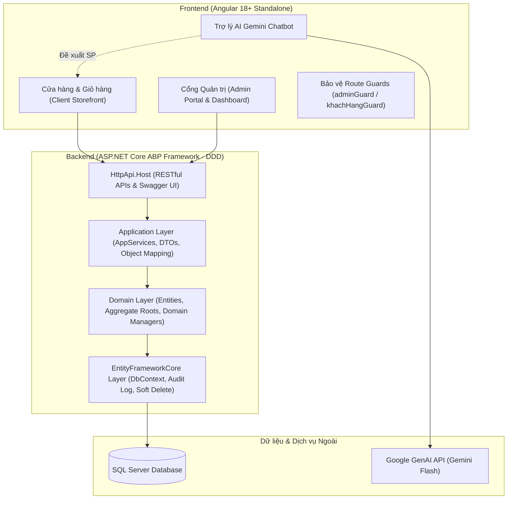

# BÁO CÁO TIẾN ĐỘ BÀI TẬP LỚN (ĐỢT 1 - NGÀY 04/10/2026)
## HỆ THỐNG QUẢN LÝ CỬA HÀNG & BÁN HÀNG TRỰC TUYẾN (testtttt88)

> **Dự án: Xây dựng Hệ Thống Quản Lý Cửa Hàng & Bán Hàng Trực Tuyến Đa Nền Tảng Tích Hợp Trợ Lý Trí Tuệ Nhân Tạo (Gemini AI)**  
> **Phương pháp phát triển: Vibe Coding kết hợp AI Agent làm trợ lý kỹ thuật chuyên sâu.**

---

## 📌 THÔNG TIN HỌC PHẦN & SINH VIÊN BÁO CÁO

| Thông tin | Nội dung chi tiết |
| :--- | :--- |
| **Đề tài bài tập lớn** | Xây dựng Hệ thống Quản lý Cửa hàng & Bán hàng Trực tuyến Tích hợp Gemini AI |
| **Họ và tên sinh viên** | **Nguyễn Khắc Dương** |
| **Mã sinh viên** | **74DCTT22184** |
| **Lớp học phần** | **74DCTT27** |
| **Khoa / Trường** | Khoa Công nghệ Thông tin - Trường Đại học Công nghệ Giao thông Vận tải (UTT) |
| **Giảng viên hướng dẫn**| **Thầy Tô Hải Thiên** (`thienth@utt.edu.vn`) |
| **Cột mốc báo cáo** | **Đợt 1 - Ngày 04/10/2026** (File báo cáo: `README_4_11.md`) |
| **Mã nguồn dự án (Public)**| [https://github.com/Nguyen-Khac-Duong/baitaploncuoiky.git](https://github.com/Nguyen-Khac-Duong/baitaploncuoiky.git) |

---

## 1. 📖 TỔNG QUAN HỆ THỐNG (PROJECT OVERVIEW)

### 1.1. Mục tiêu và Ý nghĩa Thực tiễn
Dự án **`testtttt88`** được phát triển nhằm mục tiêu xây dựng một nền tảng bán lẻ và quản lý kho hàng toàn diện, giải quyết trọn vẹn quy trình thương mại điện tử hiện đại:
* **Cho người tiêu dùng (Khách hàng):** Cung cấp giao diện mua sắm trực tuyến trực quan, hỗ trợ duyệt sản phẩm, tìm kiếm, lọc danh mục tức thời, quản lý giỏ hàng và đặt hàng nhanh chóng. Đồng thời, hệ thống tích hợp Trợ lý Trí tuệ Nhân tạo (Gemini AI) có khả năng tương tác tự nhiên, tư vấn mua sắm dựa trên số lượng hàng thực tế trong kho.
* **Cho người quản lý (Quản trị viên):** Cung cấp cổng quản trị vận hành (Admin Dashboard) với đầy đủ nghiệp vụ kiểm soát kho hàng, theo dõi đơn đặt hàng, cập nhật trạng thái đơn và phân tích thống kê doanh thu theo thời gian thực.

### 1.2. Đối tượng Người dùng & Phân quyền
* **Khách hàng vãng lai (Guest):** Xem danh mục sản phẩm, tìm kiếm, lọc hàng hóa, trò chuyện với Trợ lý AI và thêm hàng vào giỏ.
* **Khách hàng đã đăng nhập (Registered Customer):** Đặt hàng với thông tin lưu sẵn, theo dõi tiến độ và lịch sử đơn hàng cá nhân.
* **Quản trị viên (Admin):** Toàn quyền truy cập Dashboard thống kê, quản lý vòng đời sản phẩm (CRUD), quản lý kho hàng và xử lý duyệt đơn hàng.

---

## 2. 🏛️ KIẾN TRÚC KỸ THUẬT & CÔNG NGHỆ ÁP DỤNG

Hệ thống được thiết kế theo các tiêu chuẩn kiến trúc phần mềm doanh nghiệp tiên tiến nhất hiện nay:



### 2.1. Ngăn xếp Công nghệ (Technology Stack)
* **Backend Framework:** **ASP.NET Core 9 / ABP Framework**, áp dụng chuẩn kiến trúc **DDD (Domain-Driven Design)** 4 tầng độc lập.
* **Database & ORM:** **Entity Framework Core**, **SQL Server**, tích hợp tự động cơ chế **Audit Logging** và **Soft Delete** (`IsDeleted`).
* **Frontend Framework:** **Angular 18+**, áp dụng mô hình **Standalone Components**, **Angular Signals** và **RxJS Reactive Streams**.
* **Xác thực & Bảo mật:** **OpenIddict**, **JWT**, **Angular Route Guards** (`CanActivate`), **Reactive Forms Validation**.
* **Trí tuệ nhân tạo (AI):** **Google GenAI SDK (`@google/genai`)**, tích hợp mô hình **Gemini Flash**.

### 2.2. Tổ chức Backend 4 Tầng DDD
1. **Domain Layer (`testtttt88.Domain`):**
   * [SanPham.cs](file:///c:/testtttt88/aspnet-core/src/testtttt88.Domain/SanPhams/SanPham.cs): Entity sản phẩm kế thừa `FullAuditedAggregateRoot<Guid>`.
   * [DonHang.cs](file:///c:/testtttt88/aspnet-core/src/testtttt88.Domain/DonHangs/DonHang.cs) & [ChiTietDonHang.cs](file:///c:/testtttt88/aspnet-core/src/testtttt88.Domain/DonHangs/ChiTietDonHang.cs): Quản lý Aggregate đơn hàng và chi tiết sản phẩm trong đơn.
   * [DonHangManager.cs](file:///c:/testtttt88/aspnet-core/src/testtttt88.Domain/DonHangs/DonHangManager.cs): Đảm bảo toàn vẹn nghiệp vụ kiểm tra tồn kho, trừ kho an toàn khi đặt hàng và chuyển trạng thái đơn.
   * [SanPhamManager.cs](file:///c:/testtttt88/aspnet-core/src/testtttt88.Domain/SanPhams/SanPhamManager.cs): Quản lý ràng buộc tính duy nhất của mã sản phẩm và logic tạo/sửa sản phẩm.
2. **Application.Contracts Layer (`testtttt88.Application.Contracts`):**
   * Chứa các Interface dịch vụ: [ISanPhamAppService.cs](file:///c:/testtttt88/aspnet-core/src/testtttt88.Application.Contracts/SanPhams/ISanPhamAppService.cs), [IDonHangAppService.cs](file:///c:/testtttt88/aspnet-core/src/testtttt88.Application.Contracts/DonHangs/IDonHangAppService.cs).
   * Chứa các DTOs an toàn: `SanPhamDto`, `CreateUpdateSanPhamDto`, `DonHangDto`, `CreateDonHangDto`, `ThongKeDashboardDto`.
   * Hệ thống phân quyền [testtttt88Permissions.cs](file:///c:/testtttt88/aspnet-core/src/testtttt88.Application.Contracts/Permissions/testtttt88Permissions.cs).
3. **Application Layer (`testtttt88.Application`):**
   * [SanPhamAppService.cs](file:///c:/testtttt88/aspnet-core/src/testtttt88.Application/SanPhams/SanPhamAppService.cs) & [DonHangAppService.cs](file:///c:/testtttt88/aspnet-core/src/testtttt88.Application/DonHangs/DonHangAppService.cs): Xử lý điều phối dữ liệu, phân trang danh sách và mapping qua `ObjectMapper`.
4. **EntityFrameworkCore Layer (`testtttt88.EntityFrameworkCore`):**
   * [testtttt88DbContext.cs](file:///c:/testtttt88/aspnet-core/src/testtttt88.EntityFrameworkCore/EntityFrameworkCore/testtttt88DbContext.cs): Cấu hình DbSet, quan hệ thực thể, kích hoạt tự động Audit Log và cơ chế lọc xóa mềm.

---

## 3. 🎯 BÁO CÁO CÁC PHÂN HỆ VÀ TÍNH NĂNG ĐÃ HOÀN THIỆN

### 3.1. Phân hệ Cửa hàng & Trải nghiệm Mua sắm (Client)
* **Trưng bày & Tìm kiếm Sản phẩm (`/cua-hang`):**
  * Giao diện dạng lưới (Grid Card) hiện đại với hình ảnh, nhãn danh mục, đơn giá VNĐ và trạng thái còn/hết hàng.
  * Bộ lọc danh mục nhanh: Tất cả, Điện thoại, Laptop, Phụ kiện, Âm thanh, Màn hình...
  * Tìm kiếm theo từ khóa thời gian thực với Angular Signals, phản hồi tức thì mà không cần tải lại trang.
  * Thêm vào giỏ hàng một chạm có kiểm tra số lượng tồn kho và hiển thị Toast thông báo.
* **Giỏ hàng Tương tác (`/gio-hang`):**
  * Tăng / giảm số lượng sản phẩm có kiểm tra trần tồn kho thực tế.
  * Xóa từng sản phẩm hoặc làm mới toàn bộ giỏ hàng.
  * Tự động tính toán tổng số tiền thanh toán theo thời gian thực.
* **Quy trình Đặt hàng & Thanh toán (Checkout):**
  * Form đặt hàng Reactive Forms với các bộ kiểm tra: Họ tên ($\ge 2$ ký tự), Số điện thoại (9-11 chữ số hợp lệ), Địa chỉ giao hàng ($\ge 5$ ký tự), Ghi chú.
  * Tự động đồng bộ thông tin nếu khách hàng đã đăng nhập.
  * Tự động sinh mã đơn hàng chuẩn (`DH...`), lưu trữ dữ liệu và trừ số lượng tồn kho tương ứng.
* **Lịch sử Đơn hàng Cá nhân (`/don-hang-cua-toi`):**
  * Được bảo vệ an toàn bởi `khachHangGuard`.
  * Khách hàng theo dõi danh sách tất cả các đơn hàng đã đặt kèm timeline trạng thái: *Chờ xử lý $\rightarrow$ Đang giao $\rightarrow$ Hoàn thành / Đã hủy*.
  * Xem chi tiết từng món đồ đã mua, số lượng, đơn giá và tổng số tiền thanh toán.

### 3.2. Phân hệ Trợ lý Trí tuệ Nhân tạo (Gemini AI Shopping Assistant)
* **Chatbot Tư vấn Bán hàng Trực tuyến (`ChatBotComponent`):**
  * Widget trò chuyện dạng popup nổi tại góc màn hình, tương thích trên mọi kích thước thiết bị.
  * Sử dụng thư viện chính thức Google GenAI SDK (`@google/genai`) kết nối trực tiếp với mô hình Gemini Flash.
  * **Tư vấn thông minh theo ngữ cảnh kho hàng:** AI được cung cấp danh sách mặt hàng thực tế của cửa hàng để đưa ra câu trả lời chính xác, tránh hiện tượng sinh thông tin ảo (Hallucination).
  * **Đề xuất sản phẩm trực quan:** Tự động trích xuất các mặt hàng liên quan trong lời tư vấn thành các thẻ sản phẩm tương tác (có ảnh, giá và liên kết dẫn thẳng đến giỏ hàng/chi tiết).
  * Lưu trữ cấu hình API Key vào LocalStorage tiện lợi và an toàn.

### 3.3. Phân hệ Quản trị Vận hành Cửa hàng (Admin Portal)
* **Dashboard Thống kê Tổng quan (`/admin/tong-quan`):**
  * 4 Thẻ chỉ số KPI quan trọng: Tổng doanh thu (VNĐ), Tổng số đơn hàng, Tổng số mặt hàng, Cảnh báo số sản phẩm đã/sắp hết hàng.
  * Bảng danh sách các đơn hàng mới nhất và danh sách các sản phẩm đang cạn kiệt trong kho.
* **Quản lý Kho & Sản phẩm (`/admin/san-pham`):**
  * Bảng danh sách sản phẩm phân trang, tìm kiếm và lọc danh mục.
  * Thêm mới / Chỉnh sửa sản phẩm với Reactive Forms: kiểm tra ràng buộc mã sản phẩm duy nhất, đơn giá tối thiểu và số lượng tồn kho.
  * Xóa sản phẩm an toàn (Soft Delete): Dữ liệu được đánh dấu ẩn `IsDeleted` thay vì xóa vĩnh viễn khỏi DB, đảm bảo toàn vẹn dữ liệu đơn hàng trong quá khứ.
* **Quản lý & Duyệt Đơn hàng (`/admin/don-hang`):**
  * Danh sách toàn bộ đơn hàng của tất cả khách hàng.
  * Lọc theo trạng thái và tìm kiếm nhanh theo mã đơn / tên / số điện thoại khách.
  * Thay đổi trạng thái đơn hàng (Duyệt đơn, Chuyển giao hàng, Hoàn tất, Hủy đơn) kèm bảo vệ phân quyền backend `testtttt88Permissions.DonHangs.EditStatus`.
  * Modal xem chi tiết đơn hàng: Thông tin khách hàng, địa chỉ giao hàng và danh sách từng sản phẩm cùng đơn giá chi tiết.

### 3.4. Phân hệ Xác thực & Phân quyền (Authentication & Authorization)
* **Đăng nhập & Đăng ký Đa vai trò (`/dang-nhap`, `/dang-ky`):**
  * Chuyển đổi linh hoạt giữa tab Đăng nhập và Đăng ký.
  * Cung cấp nút chọn nhanh tài khoản mẫu:
    * **Admin:** `admin@gmail.com` / `123456`
    * **Khách hàng:** `khachhang@gmail.com` / `123456`
  * Form đăng ký khách hàng với Reactive Forms validation chặt chẽ: kiểm tra định dạng email, độ dài mật khẩu và kiểm tra trùng khớp mật khẩu xác nhận.
* **Bảo vệ Tuyến đường (Route Guards):**
  * [xac-thuc.guard.ts](file:///c:/testtttt88/angular/src/app/he-thong/bao-ve/xac-thuc.guard.ts):
    * `adminGuard`: Ngăn chặn triệt để khách hàng hoặc người dùng vãng lai truy cập vào khu vực Quản trị (`/admin/*`).
    * `khachHangGuard`: Đảm bảo chỉ khách hàng đã đăng nhập mới xem được lịch sử đơn hàng cá nhân.

---

## 4. 💡 PHƯƠNG PHÁP PHÁT TRIỂN & QUẢN TRỊ MÃ NGUỒN

### 4.1. Ứng dụng Mô hình "Vibe Coding" với AI Agent
* **Định vị vai trò:**
  * Sinh viên giữ vai trò **Kiến trúc sư trưởng (System Architect)**: Lập kế hoạch phân rã module, thiết kế sơ đồ dữ liệu, lựa chọn công nghệ, đặt ra các ràng buộc an toàn và thẩm định chất lượng mã nguồn.
  * AI Agent giữ vai trò **Trợ lý Kỹ thuật Chuyên sâu (Senior AI Pair Programmer)**: Hỗ trợ triển khai nhanh boilerplate, sinh mã DTOs, cấu hình mapper và xây dựng các component giao diện theo đúng kiến trúc đề ra.
* **Quy trình 4 bước kiểm soát mã nguồn:**
  1. *Phân rã bài toán (Decomposition):* Tách bạch từng chức năng theo các tầng Domain $\rightarrow$ Contracts $\rightarrow$ Application $\rightarrow$ Frontend UI.
  2. *Cung cấp ngữ cảnh (Contextual Prompting):* Đưa đầy đủ ràng buộc kỹ thuật (Angular 18 Standalone, ABP Domain Manager, không dùng code lỗi thời).
  3. *Thẩm định & Kiểm soát (Code Verification):* Chạy `dotnet build` và `ng build` sau mỗi lần sinh mã; kiểm tra từng dòng diff để loại bỏ nguy cơ bảo mật.
  4. *Tái cấu trúc & Tối ưu (Refactoring):* Loại bỏ memory leak trong RxJS với `takeUntil(this.destroy$)`, chuẩn hóa quy ước đặt tên và đóng gói component.

### 4.2. Quản lý Phiên bản với Git (Git Workflow)
* Tuân thủ quy chuẩn **Conventional Commits**:
  * `feat(module): ...`: Thêm tính năng mới.
  * `fix(module): ...`: Sửa lỗi phát sinh.
  * `refactor(module): ...`: Tái cấu trúc mã nguồn theo chuẩn ABP Domain Manager / Angular Signals.
  * `docs: ...`: Cập nhật tài liệu kỹ thuật và báo cáo tiến độ.
* **Atomic Commits:** Mỗi commit giải quyết trọn vẹn một mục tiêu duy nhất, có mô tả chi tiết, rõ ràng.
* **Clean Git Tree:** Toàn bộ thư viện và file biên dịch tạm thời (`node_modules/`, `bin/`, `obj/`, `.vs/`, `.vscode/`) đều được cấu hình loại trừ sạch sẽ trong [.gitignore](file:///c:/testtttt88/.gitignore).

### 4.3. Kiểm thử & Đảm bảo Chất lượng Hệ thống
1. **Kiểm thử API Endpoint với Swagger UI:**
   * Truy cập `https://localhost:44351/swagger` để kiểm tra toàn bộ RESTful API cho cả hai module Sản phẩm và Đơn hàng.
   * Xác thực mã phản hồi HTTP (`200 OK`, `400 Bad Request`, `401 Unauthorized`, `403 Forbidden`).
2. **Kiểm thử Client-side Reactive Forms Validation:**
   * Giám sát trạng thái form qua các thuộc tính: `invalid`, `touched`, `dirty`.
   * Vô hiệu hóa nút Submit khi dữ liệu chưa hợp lệ và hiển thị thông báo lỗi tương ứng.
3. **Kiểm thử Bảo mật Phân quyền Tuyến đường:**
   * Mở tab ẩn danh truy cập URL `/admin/san-pham` $\rightarrow$ Hệ thống tự động kích hoạt Guard chặn truy cập và chuyển hướng về `/dang-nhap`.

---

## 5. 🚀 HƯỚNG DẪN CÀI ĐẶT & KHỞI CHẠY (SETUP GUIDE)

### 5.1. Yêu cầu Môi trường
* **.NET SDK:** Phiên bản 8.0 hoặc 9.0 trở lên.
* **Node.js:** Phiên bản 18.x hoặc 20.x LTS.
* **Cơ sở Dữ liệu:** SQL Server (LocalDB mặc định).

### 5.2. Khởi chạy Backend (ASP.NET Core ABP)
```bash
cd aspnet-core/src/testtttt88.HttpApi.Host
dotnet run
```
* **Swagger UI:** `https://localhost:44351/swagger`

### 5.3. Khởi chạy Frontend (Angular 18+)
```bash
cd angular
npm install
npm start
```
* **Ứng dụng Web:** `http://localhost:4200`

### 5.4. Tài khoản Demo Trải nghiệm Hệ thống
| Vai trò | Email đăng nhập | Mật khẩu | Phạm vi quyền hạn |
| :--- | :--- | :--- | :--- |
| **Quản trị viên (Admin)** | `admin@gmail.com` | `123456` | Toàn quyền Quản trị & Cửa hàng |
| **Khách hàng (Client)** | `khachhang@gmail.com` | `123456` | Mua hàng, Giỏ hàng, Đặt hàng, Đơn cá nhân |

---

## 6. 📊 TỔNG KẾT TIẾN ĐỘ ĐỢT 1 & KẾ HOẠCH ĐỢT 2

### 6.1. Đánh giá Mức độ Hoàn thành Đợt 1 (Ngày 04/10/2026)
* [x] **Backend ABP DDD 4 tầng:** Hoàn thành 100% cấu trúc thực thể Domain, Domain Managers, DTOs, AppServices, DbContext, Audit Logging và Soft Delete.
* [x] **Frontend Angular 18+ Standalone:** Hoàn thành 100% giao diện Client Storefront, Giỏ hàng, Đặt hàng, Lịch sử đơn hàng, Admin Dashboard, Quản lý kho sản phẩm và Quản lý đơn hàng.
* [x] **Tích hợp Trợ lý Trí tuệ Nhân tạo:** Hoàn thành tích hợp Google GenAI (Gemini Flash) với tính năng trích xuất sản phẩm thông minh từ kho hàng.
* [x] **Bảo mật & Phân quyền:** Hoàn thành hệ thống RBAC, bảo vệ Route Guards và Reactive Forms Validation.

### 6.2. Kế hoạch Thực hiện Đợt 2 (Ngày 11/10/2026)
* [ ] Tích hợp cổng thanh toán trực tuyến (VNPay / MoMo Sandbox).
* [ ] Hệ thống gửi Email thông báo tự động cho khách hàng khi trạng thái đơn thay đổi.
* [ ] Bổ sung tính năng Đánh giá & Nhận xét sản phẩm (Review & Rating).

---

*Báo cáo được hoàn thiện và nộp theo đúng mốc thời gian quy định trên GitHub.*
